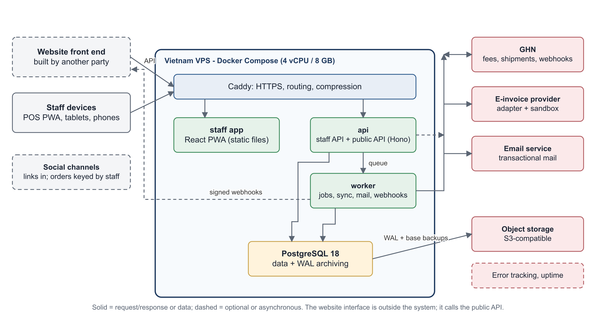
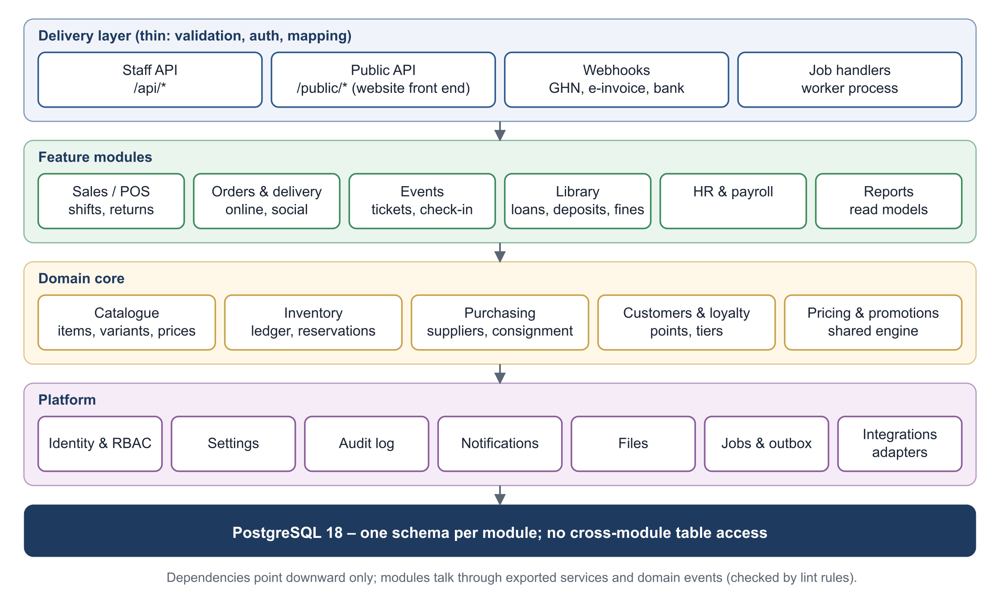
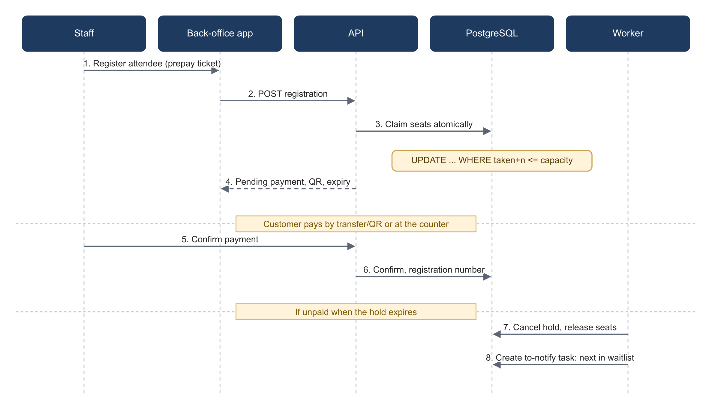
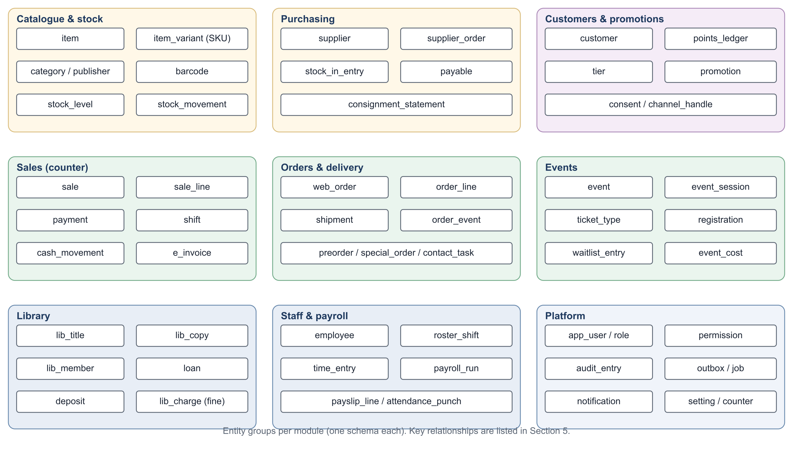
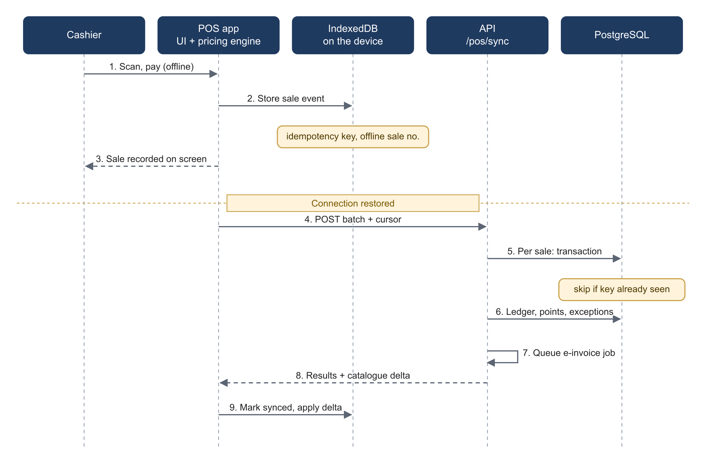

# Technical Design Document – Bookstore Management System

**TypeScript · Node.js · PostgreSQL · React PWA · Public API**

|  |  |
| --- | --- |
| **Document version** | 1.1 – Final |
| **Date** | 21 October 2026 (revised 24 October 2026) |
| **Derived from** | SRS v1.1 – Bookstore Management System (255 requirements) |
| **Changes in 1.1** | Import kind `stock_in` added for bulk stock-in (FR-PUR-14); SKU and ISBN stay separate import columns. Website text is stored English-first (`{ en, vi? }`) and the public API falls back to English (FR-WEB-22). The dashboard drops the operational alert tiles (orders waiting, overdue to-notify tasks, shift variances, failed e-invoices); these become in-app notifications and menu count badges (FR-RPT-01, FR-ADM-08). **25 Oct 2026:** loyalty points are a discount, not a payment method (§4.4, `sale_payment`); settings `inventory.adjust_approval_vnd`, `catalog.duplicate_mode`, store profile, sales-slip footer and MISA credentials added to Appendix A; document number prefixes (§3.6) and the derived permission keys (§10.3) recorded; offline POS: device signature, offline shift ids, `pos.offline.manage`, device and sync-exception endpoints (§6.2, §7.2, §10.3); bank transfers use the store’s printed QR code and a `payment_ref` the customer types; the VietQR generator and `PaymentQrAdapter` are removed (§4.4, §4.5, §4.6, §6.2, §8.1, §8.4); `search_text` is maintained by the catalogue service (§4.1); setup wizard, PIN and account-unlock endpoints added (§6.2); permission `user.unlock` for owner and manager (§6.2, §10.3); catalogue variant, price, lookup and category endpoints, count submit, low-stock, valuation and multi-line stock-in endpoints listed (§6.2); POS registers, shift reads, sale detail and e-invoice list endpoints; void and out-of-window return approval by supervisor token; shift-variance notification recipients (§4.4); default tier seeding (§4.9); store-credit ledger and payment method (§4.4, §4.9, §5.3, §5.4, §6.2); report definitions, R1 report views and export token endpoints (§4.11, §6.2); label templates and barcodes (§4.1), customer merge rules (§4.9), master-data seeds (§4.12), import rollback (§4.12), bundles without own stock (§4.1), supplier-order receiving, reorder suggestion formula and consignment deadline alerts (§4.3, §9.1, Appendix A), purchase history, data export, master data and catalogue export endpoints, offline returns event (§6.2, §7.5); consignment statement price basis and read endpoints (§4.3, §6.2); optional images on import, file storage, import and product-photo endpoints (§4.3, §4.12, §6.2). **27 Oct 2026:** sales list `status` and `method` accept several values; customer list filters and purchase stats; item create takes an optional opening stock; product list rows carry `lastMovementAt`; stock movements carry the source document number and supplier; one stock location, so adjustments and counts always use `floor`; reason codes `expired` and `import_rollback` dropped from the seed; stock counts: scope by product type, count sheet download/upload, cancel endpoint, typed entry limited to 50 lines, list search and filters (§4.2, §6.2); reorder suggestions (FR-PUR-08), their endpoint and the `purchasing.velocity_days` / `reorder_cover_days` settings removed; supplier orders (FR-PUR-07) removed – endpoints, service and the stock-in `orderLineId` dropped, tables retired (§4.3, §5, §6.2, Appendix A); supplier payables (FR-PUR-06) removed – payables endpoints, the stock-in `payableVnd`, the supplier `tracksPayables` flag and `termsDays` field and the `payables` report view dropped; supplier API takes `phone`/`email` instead of `kind`, `contacts` and `bank`; item create takes consignment opening stock (`opening.supplierId`, `consignment`, terms), tables kept unused; permission `purchasing.payables` now only covers consignment statements (§4.3, §6.2, §11); product list filters by kind and several categories/statuses/stock states and returns on-hand, cost (with permission) and last update; categories carry the item kinds they hold; shift history takes `q` (shift number or cashier name) and `register` (comma-separated register ids) besides `from`/`to` (§6.2); store credit removed from payments, refunds, merge and the API (§4.4, §4.9, §5.3, §6.2); dashboard returns today’s figures only; its trend and channel charts read the sales report for a user-chosen range (§4.11); user, supplier (name or phone digits) and consignment-lot lists take `q`; the temporary password for a new user is generated in the browser; the create-product page requires a supplier and an opening quantity and posts them as the first `SI` stock-in (§6.2); ESLint runs as `pnpm lint` with its packages in `tools/lint` (typescript-eslint needs the TypeScript 6 API, `@typescript/typescript6`, while the code compiles with TypeScript 7) – rules in force: no `any` outside tests, no `sql.raw` (two reviewed exceptions for constant identifiers), module imports only through another module’s `index.js`, React hooks rules; the money/float rule and dependency-cruiser are not wired yet (§2.4, §12.4). **27 Oct:** Reports: `sales?groupBy=cashier` removed; `groupBy=item` returns `sku` and `title` as separate columns; report export is XLSX only (no CSV) (§4.11, §8). **3 Nov:** `sales?groupBy=category` and `groupBy=payment` removed; `inventory?view=counts|consignment` and `purchasing?view=consignment` removed; `inventory?view=slow` replaced by `catalog/items?unsoldDays=` (§8). Releases follow SRS §9: R2a (staff-worked online and social orders: `/api/v1/orders/*`, `/api/v1/contact-tasks/*`, `/webhooks/ghn`, GHN adapter and jobs) comes next; R2b (public API `/public/v1/*`, carts, checkout, accounts, website content) is built after R5, and its checkout calls the same order service as staff order entry. **3 Nov (R2a design):** online orders are numbered `DH` (§3.6); §4.5 adds pricing, review flags with settings `order.review_high_value_vnd` and `order.review_failed_deliveries`, the stock and revenue moments (SRS BR-29), store pickup Packing → Done and whole- or part-order returns; `web_order` gains `channel_id`, `delivery`, the priced amounts, `review_reasons`, `read_at`, pickup and done/cancel columns, `order_line` the priced and cost columns, `return_request` its lines; geo tables `orders.geo_province` / `orders.geo_ward` keep GHN's district behind each ward (§5.3, §8.2); job `geo.refresh` (§9.1); figures for online orders by `done_at` (§4.11). Pre-orders (`DT`) and special orders (`DR`): deposit taken at the counter (cash as a `cash_movement` into the open shift, transfer or card with a reference), held for the customer; collecting creates an online order at the agreed price with `web_order.deposit_vnd`, so COD and transfer collect only the rest; `contact_task.due_hours` (24) sets the worklist deadline; `preorder.expire` alerts, staff cancel with refund or forfeit (§4.5, §5.3, §6.2, §9.1, Appendix A). FR-SOC-04 in R2a: `POST /api/v1/share-links` returns the product link (setting `web.product_url`, a template with `{slug}`) and the text card without storing a `share_link`; UTM tagging and stored links come with FR-SOC-05 in R2b (§4.6, §6.2, Appendix A). Reports read `reports.sale_doc`, `reports.sale_line` and `reports.return_line`, views over counter sales and Done online orders; the shipping fee charged is a line without a product (§4.11). **3 Nov (POS pre-orders):** pre-orders are taken and collected at the POS with `sale.create`; collecting is a counter sale with `preorder_id`, the agreed price and a `deposit` payment row; `web_order.deposit_vnd` and the online-order collection are dropped; special orders (`special_order`, `DR`, `special_order_arrived`) are removed (§3.6, §4.5, §5.3, §6.2, §9.1). A pre-order has lines (`preorder_line`: variant, quantity, agreed unit price, `reserved_at`); allocation holds line by line and the pre-order is Arrived when every line is held; `preorder.source` is `other` for pre-orders taken at the POS (§4.5, §5.3). The to-notify worklist is withdrawn: `contact_task`, `/api/v1/contact-tasks/*`, the `contact_task.overdue` job, the `contact_task.due_hours` setting, the `contact_task.manage` permission and the “Cần liên hệ” badge are removed; `POST /api/v1/preorders/{id}/contacted` starts the holding period (§4.5, §5.3, §6.2, §9.1, Appendix A). Library reworked (SRS 3 Nov): `lib_title.code` and copy barcodes `code-n` with book labels; copy statuses `available|reserved|on_loan|lost|damaged`; borrowers are customers (`lib_member` and `lib_rule_set` removed, rules are `library.*` settings); `lib_charge` gains kind `loan_fee` and is paid through the POS; `deposit_txn` and the deposit endpoints are deferred; library reminder emails become the `library.reminders` job and the `library.loans_to_call` in-app alert (§4.8, §5.3, §6.2, §8.5, §9.1, Appendix A). `lib_copy.reference_only` is removed; the loan fee is discounted for lifetime goods spend from `library.fee_discount_spend_vnd` (`loanFee`, `lib_charge.list_vnd` / `discount_pct`, FR-LIB-18). |
| **Hosting** | One Vietnam-based VPS, Docker Compose; S3-compatible backup storage in Vietnam |
| **Status** | Approved for construction |

## Table of Contents

- [1. Introduction](#1-introduction)
  - [1.1 Purpose and audience](#11-purpose-and-audience)
  - [1.2 Conventions](#12-conventions)
- [2. Technology Stack and Engineering Rules](#2-technology-stack-and-engineering-rules)
  - [2.1 Stack](#21-stack)
  - [2.2 Version policy](#22-version-policy)
  - [2.3 Engineering rules](#23-engineering-rules)
- [3. Architecture](#3-architecture)
  - [3.1 Architectural style: a modular monolith](#31-architectural-style-a-modular-monolith)
  - [3.2 Deployment view](#32-deployment-view)
  - [3.3 Logical view](#33-logical-view)
  - [3.4 Repository layout](#34-repository-layout)
  - [3.5 Request lifecycle](#35-request-lifecycle)
  - [3.6 Cross-cutting design rules](#36-cross-cutting-design-rules)
- [4. Module Designs](#4-module-designs)
  - [4.1 Catalogue (CAT)](#41-catalogue-cat)
  - [4.2 Inventory (INV)](#42-inventory-inv)
  - [4.3 Purchasing, suppliers and consignment (PUR)](#43-purchasing-suppliers-and-consignment-pur)
  - [4.4 Point of sale and shifts (POS)](#44-point-of-sale-and-shifts-pos)
  - [4.5 Online and social orders, delivery (ORD)](#45-online-and-social-orders-delivery-ord)
  - [4.6 Website back end (public API), social channels and content management (WEB, SOC)](#46-website-back-end-public-api-social-channels-and-content-management-web-soc)
  - [4.7 Events (EVT)](#47-events-evt)
  - [4.8 Library (LIB)](#48-library-lib)
  - [4.9 Customers, loyalty and promotions (CRM, PRM)](#49-customers-loyalty-and-promotions-crm-prm)
  - [4.10 Staff, fingerprint timekeeping and payroll (HR)](#410-staff-fingerprint-timekeeping-and-payroll-hr)
  - [4.11 Reports (RPT)](#411-reports-rpt)
  - [4.12 Administration and platform (ADM)](#412-administration-and-platform-adm)
- [5. Data Design](#5-data-design)
  - [5.1 Conventions](#51-conventions)
  - [5.2 Domain overview](#52-domain-overview)
  - [5.3 Table catalogue](#53-table-catalogue)
  - [5.4 Integrity mechanisms in the database](#54-integrity-mechanisms-in-the-database)
  - [5.5 Volume and retention](#55-volume-and-retention)
- [6. API Design](#6-api-design)
  - [6.1 Conventions](#61-conventions)
  - [6.2 Endpoint catalogue](#62-endpoint-catalogue)
- [7. Offline POS Design](#7-offline-pos-design)
  - [7.1 Scope offline](#71-scope-offline)
  - [7.2 Device registration and offline lease](#72-device-registration-and-offline-lease)
  - [7.3 Local data and catalogue delta](#73-local-data-and-catalogue-delta)
  - [7.4 Recording an offline sale](#74-recording-an-offline-sale)
  - [7.5 Synchronisation protocol](#75-synchronisation-protocol)
  - [7.6 Conflict and exception rules](#76-conflict-and-exception-rules)
  - [7.7 Local security](#77-local-security)
  - [7.8 Offline event check-in](#78-offline-event-check-in)
  - [7.9 Application updates](#79-application-updates)
  - [7.10 Verification](#710-verification)
- [8. Integrations](#8-integrations)
  - [8.1 Adapter pattern](#81-adapter-pattern)
  - [8.2 GHN](#82-ghn)
  - [8.3 MISA meInvoice](#83-misa-meinvoice)
  - [8.4 Bank transfer and payment confirmation](#84-bank-transfer-and-payment-confirmation)
  - [8.5 Email](#85-email)
  - [8.6 Fingerprint terminals](#86-fingerprint-terminals)
  - [8.7 Printing and hardware](#87-printing-and-hardware)
- [9. Background Jobs and Events](#9-background-jobs-and-events)
  - [9.1 Job catalogue](#91-job-catalogue)
  - [9.2 Domain events and the outbox](#92-domain-events-and-the-outbox)
- [10. Security Design](#10-security-design)
  - [10.1 Threats and controls](#101-threats-and-controls)
  - [10.2 Authentication and sessions](#102-authentication-and-sessions)
  - [10.3 Authorisation](#103-authorisation)
  - [10.4 Data protection](#104-data-protection)
  - [10.5 Audit](#105-audit)
  - [10.6 Secrets and configuration](#106-secrets-and-configuration)
  - [10.7 Supply chain and dependencies](#107-supply-chain-and-dependencies)
  - [10.8 Host security](#108-host-security)
- [11. Performance, Capacity and Reliability](#11-performance-capacity-and-reliability)
  - [11.1 Workload model](#111-workload-model)
  - [11.2 Targets and mechanisms](#112-targets-and-mechanisms)
  - [11.3 Database tuning (starting values for 8 GB RAM)](#113-database-tuning-starting-values-for-8-gb-ram)
  - [11.4 Backup, recovery and availability](#114-backup-recovery-and-availability)
  - [11.5 Observability](#115-observability)
- [12. Deployment and Operations](#12-deployment-and-operations)
  - [12.1 Environments](#121-environments)
  - [12.2 Compose topology](#122-compose-topology)
  - [12.3 Environment configuration](#123-environment-configuration)
  - [12.4 CI/CD pipeline](#124-cicd-pipeline)
  - [12.5 Provisioning and runbooks](#125-provisioning-and-runbooks)
  - [12.6 Hosting requirements and budget](#126-hosting-requirements-and-budget)
- [13. Test Strategy](#13-test-strategy)
  - [13.1 Layers](#131-layers)
  - [13.2 Concurrency and invariant tests (must exist)](#132-concurrency-and-invariant-tests-must-exist)
  - [13.3 Test data](#133-test-data)
  - [13.4 Performance and surge tests](#134-performance-and-surge-tests)
  - [13.5 Acceptance](#135-acceptance)
- [14. Requirements Traceability](#14-requirements-traceability)
  - [14.1 SRS modules to design elements](#141-srs-modules-to-design-elements)
  - [14.2 Non-functional requirements to mechanisms](#142-non-functional-requirements-to-mechanisms)
- [Appendix A. Settings Registry](#appendix-a-settings-registry)

## 1. Introduction

### 1.1 Purpose and audience

This Technical Design Document (TDD) turns the Software Requirements Specification (SRS v1.0) of the Bookstore Management System (BMS) into an implementable design: technology stack, architecture, module designs, data model, API, offline POS, integrations, background jobs, security, performance and recovery, deployment and test strategy. It is written for the developers and the technical owner who build and review the system. Section 14 traces every SRS module and non-functional requirement to the design.

### 1.2 Conventions

- SRS requirement IDs (for example FR-POS-19, NFR-AVL-02) are quoted where a design element implements them.
- Code identifiers, table names, settings keys and paths are shown in `monospace`. SQL is PostgreSQL dialect.
- “MUST” marks a design rule that is enforced by tooling or tests, not by convention.
- Default parameter values are in Appendix A; they live in the settings registry, never in code.

## 2. Technology Stack and Engineering Rules

### 2.1 Stack

| Concern | Choice | Role |
| --- | --- | --- |
| Language | TypeScript (strict mode, ES modules) | One language for the server, the staff app, the offline POS and the shared domain package. |
| Runtime | Node.js LTS (24.x at project start) | API, worker and tooling. |
| Database | PostgreSQL 18 | System of record; continuous archiving for point-in-time recovery; accent-insensitive search. |
| Monorepo | pnpm workspaces | `apps/api`, `apps/worker`, `apps/staff`, `packages/*`. |
| API framework | Hono with `@hono/zod-openapi` | Typed routes; OpenAPI description generated from the schemas. |
| Validation | Zod | Requests, responses, queue payloads, settings, content, offline records. |
| Data access | Drizzle ORM, drizzle-kit migrations, `postgres` driver | Typed schema; raw SQL allowed in repositories for reports and locks. |
| Queue and scheduler | pg-boss | Cron in Asia/Ho_Chi_Minh, retries, dead letters, in the same PostgreSQL. |
| Staff app and POS | React 19, Vite, React Router, TanStack Query, Zustand, Tailwind CSS, shadcn/ui | Installable PWA with list/filter/detail patterns. |
| Offline | Workbox service worker, Dexie (IndexedDB), Web Crypto, Web Locks | Section 7. |
| Authentication | Opaque session tokens, argon2id, TOTP | No external identity service (Section 10). |
| Documents | pdfkit (Vietnamese font embedded), exceljs, qrcode, sharp | E-invoice copies, labels (including library book labels), payslips, statements, exports, image derivatives. |
| Barcode scanning | Keyboard-wedge scanners; `BarcodeDetector` with the `barcode-detector` fallback | Camera scanning on tablets and phones. |
| Email | Nodemailer over a provider API/SMTP behind an adapter | Reminders and account messages only. |
| Observability | pino logs, Sentry-compatible error tracking, uptime checks | Section 11.5. |
| Testing | Vitest, Testcontainers, Playwright, fast-check, k6, axe-core | Section 13. |
| CI/CD | GitHub and GitHub Actions; images in a container registry | Section 12.4. |
| Containers and proxy | Docker Compose, Caddy | One Vietnam VPS, automatic HTTPS. |
| Backups | pgBackRest to S3-compatible storage in Vietnam | Continuous WAL archiving and base backups. |

### 2.2 Version policy

- Production runs only LTS Node.js lines; the project starts on 24.x and moves to the next LTS after the dependency tree passes the full test suite on it.
- PostgreSQL 18.x with the latest minor release applied.
- Dependencies are pinned by lockfile; upgrades are batched monthly and gated by the full test suite.

### 2.3 Engineering rules

- **Strict TypeScript** (`strict`, `noUncheckedIndexedAccess`, `exactOptionalPropertyTypes`) and ESLint rules that forbid `any`, floating-point arithmetic on money, and cross-module imports (MUST).
- **Pure domain packages** (money, pricing, tax, points, loan rules, fines, payroll, state machines, collection rules, content validation) with exhaustive unit and property-based tests.
- **Schema as the contract:** Zod schemas generate the OpenAPI description and the client types, so a mismatch breaks the build.
- **Small, named modules** with a documented public interface and a short `README` each.
- **Review checklist:** money and stock change only through the domain services; every new endpoint declares a permission; every migration follows expand/contract; every new dependency has a recorded reason.

## 3. Architecture

### 3.1 Architectural style: a modular monolith

The BMS is one codebase and one database with a handful of deployable processes (`api`, `worker`, staff-app static files, PostgreSQL, Caddy) and strict module boundaries inside. A sale, its stock movement, points and audit entry are committed in one transaction. Module boundaries allow extracting a service later.

### 3.2 Deployment view



*Figure 1 – Deployment view: one Vietnam VPS running Docker Compose, with external services*

| Container | Process | Responsibility |
| --- | --- | --- |
| caddy | Caddy | Automatic TLS, HTTP/2, compression, routing: `/staff` static PWA; `/api`, `/public`, `/webhooks`, `/pos` and `/devices` to the API. The website front end is hosted elsewhere. |
| api | Node + Hono | All synchronous business operations: staff API, public API, webhook receivers, `/pos/v1/sync`, attendance-terminal receiver. |
| worker | Node (same image as api) | pg-boss consumers and schedules: e-invoice, email, GHN polling, reminders, expiry, collection refresh, content publishing, outbound webhooks, imports. |
| migrate | Node (one-shot) | Applies database migrations before `api` and `worker` start. |
| postgres | PostgreSQL 18 | System of record; WAL archived continuously to object storage. |
| staff app | Static files | The React PWA served by Caddy with hashed assets and a never-cached service worker file. |

### 3.3 Logical view



*Figure 2 – Logical view: layers and modules; dependencies point downward*

- The **delivery layer** (HTTP routes, webhooks, job handlers) only validates input, checks permissions, calls a module service and maps the result. It contains no business rules.
- **Feature modules** may call **domain core** and **platform** modules, never each other sideways except through published domain events. For example, Orders reacts to a `stock_in.posted` event from Purchasing instead of importing it.
- **Domain core** modules may call **platform** and, in the order Catalogue → Inventory → Purchasing, the earlier core modules (quick stock-in creates products through the Catalogue service); Customers and Pricing depend on Catalogue only. Platform never calls upward.
- Each module exposes a single `index.ts`; importing another module’s internals fails the build (`dependency-cruiser`). Each module owns its own PostgreSQL **schema**; cross-module SQL joins are allowed only in read models (Reports).

### 3.4 Repository layout

```
bookstore/
  apps/
    api/            Hono app: routes, middleware, webhooks, /pos/v1/sync, /devices
    worker/         pg-boss registration; job handlers (call module services)
    staff/          React PWA (back office + POS), service worker, Dexie stores
  packages/
    domain/         PURE TypeScript, no I/O: money, vat, pricing, promotions,
                    loyalty, loan rules, fines, payroll, state machines, isbn,
                    payment references, collection rules, content validation, permissions
                    catalogue, zod schemas shared by all apps
    modules/        one folder per module: catalog, inventory, purchasing, sales,
                    orders, web, events, library, customers, promotions, hr,
                    reports, identity, settings, audit, notifications, files,
                    integrations
    db/             drizzle schema per module, SQL migrations, seeds
    ui/             shared design tokens and components for the staff app
    testkit/        factories, fake clock, Testcontainers helpers
  infra/            docker-compose.yml, Caddyfile, cloud-init, backup config
  docs/             SRS, this TDD, runbooks
```

### 3.5 Request lifecycle

1. Caddy terminates TLS and forwards to the API with `X-Forwarded-*` headers; only Caddy can reach the API port.
2. Middleware chain: request id → structured logging → security headers → Origin/CSRF check → body size limit → rate limit → session lookup (permissions reloaded from the database on every request).
3. Route level: Zod validation of params, query and body; permission check; object-level checks (for example a customer may read only their own orders).
4. The handler calls a module service with a `Ctx`; the service opens one transaction for any state change.
5. Errors map to a typed envelope `{ error: { code, message, details?, requestId } }`; messages shown to staff are in Vietnamese and never leak internals.
6. Domain events written to the **outbox** table in the same transaction are dispatched by the worker after commit (Section 9.2).

### 3.6 Cross-cutting design rules

| Concern | Rule |
| --- | --- |
| Money | Integer VND in `bigint` columns named `*_vnd`; type `Vnd` (branded integer); **no floating-point arithmetic on money** (lint rule). Percentages are basis points; rounding is half-up in one helper. |
| Time | `timestamptz` in UTC; day grouping converts with `AT TIME ZONE 'Asia/Ho_Chi_Minh'`; injectable `Clock`. |
| Identifiers | UUIDv7 primary keys (PostgreSQL 18 `uuidv7()`). Human document numbers come from gap-free counters per series and year, formatted `PREFIX-YYYY-NNNNN`: counter sale `HD`, return `TH`, stock-in `SI`, stock adjustment `DC`, stock count `KK`, supplier order `PO` (retired), consignment statement `KG`, online order `DH`, pre-order `DT` (for example `HD-2026-00001`). Offline sales use `{device_code}-{counter}` (Section 7.4). |
| Concurrency | Atomic conditional `UPDATE ... WHERE` for counters (stock, seats); `SELECT ... FOR UPDATE` in fixed id order where several rows are needed; `version` column + `If-Match` for edited aggregates. |
| Idempotency | Every state-changing endpoint with money or stock effects accepts an `Idempotency-Key`; offline events use a client-generated event id; webhooks and terminal pushes use the provider event id or a natural key. |
| Configuration | Business parameters live in the typed `setting` registry with defaults and validation, never in code. |
| Localisation | Staff UI text externalised (Vietnamese); numbers `1.234.567 ₫`; dates `dd/MM/yyyy`; translatable website text stored as English (required) + Vietnamese (optional) (Section 4.6). |
| Feature flags | Release-gated features (events, library, payroll, public events/library endpoints) are behind settings so a module can be deployed dark and enabled per environment. |

## 4. Module Designs

Each module lists responsibilities, the data it owns, the important algorithms and invariants, the events it publishes and the API prefix. Table details are in Section 5 and endpoints in Section 6.

### 4.1 Catalogue (CAT)

| Aspect | Design |
| --- | --- |
| Owns | `item`, `item_variant` (SKU), `barcode`, `category`, `publisher`, `brand`, `price_history`, `item_image`, `bundle_component`, `import_job`. |
| Model | An **item** is the title or product; a **variant** is the sellable unit with SKU, barcodes, price, VAT rate and **weight in grams (required, FR-CAT-04)**. Books normally have one variant; stationery may have several. Bundles list components and deduct them on sale. A bundle variant holds **no stock of its own**: its available quantity is the minimum over its components of ⌊component available ÷ quantity per bundle⌋, stock-in to a bundle is refused, and its components are set with `PUT /api/v1/catalog/variants/{id}/components` (FR-CAT-12). |
| Languages | Translatable text (title for display, description, category and publisher names, SEO text) is stored as `i18n jsonb` shaped `{ en: {...}, vi?: {...} }` and validated by Zod; saving or publishing without the English text is rejected. The API resolves the requested language and falls back to `en` (FR-WEB-22). Search indexes both languages. |
| ISBN | `isbn13` normalised and checksum-validated in `packages/domain`; ISBN-10 converted on entry. Unique where present; duplicate detection also on barcode and SKU (FR-CAT-05). |
| Prices | Current price on the variant for fast reads; every change inserts a row in `price_history` with effective dates, actor and reason (FR-CAT-07, FR-CAT-08), including prices changed by a stock-in. The POS pricing engine reads the version in force at the sale time. |
| Search | Column `search_text` = lower(unaccent(title, authors, publisher, isbn, sku)), **maintained by the catalogue service** on every write of the item, its variants or its publisher (the values span several tables, so a generated column is not possible), with a GIN trigram index; exact index on ISBN/barcode. |
| Import | Excel/CSV uploaded as a file, parsed in the worker with a streaming reader into `import_row` staging, validated per row, previewed, then committed in batches; error report downloadable (FR-CAT-11). |
| Images | Original stored in object storage; derivatives (thumbnail, card, full; WebP) generated by `sharp` in the worker; the public API returns derivative URLs only (FR-WEB-19). |
| Labels | Shelf/price and barcode labels are rendered as print-optimised HTML/PDF in batches (FR-CAT-13). Templates follow Design §16.4: `shelf` (50 × 30 mm, A4 40-up), `barcode` (38 × 21 mm, A4 65-up, or 40 × 25 mm roll) and `sale_price` (30 × 20 mm); a start position reuses partly used sheets. Barcodes are inline SVG generated in `packages/domain`: EAN-13 for valid 13-digit codes (ISBN, internal `20…`), otherwise Code 128. |
| Events | `item.changed` → outbound webhook to the website front end, POS catalogue delta and collection refresh. |
| API | `/api/v1/catalog/*`, `/public/v1/catalog/*`. |

### 4.2 Inventory (INV)

| Aspect | Design |
| --- | --- |
| Owns | `stock_level`, `stock_movement`, `stock_reservation`, `stock_count`, `stock_count_line`, `stock_adjustment`. |
| Single write path | Only `inventory.apply(ctx, movement)` changes stock. It inserts the movement and updates `stock_level` in the same transaction; a trigger forbids UPDATE/DELETE on `stock_movement`, and a nightly job verifies `SUM(movement) = on_hand` for every variant. |
| No overselling | Reservation and sale use one atomic statement: `UPDATE stock_level SET reserved = reserved + :q WHERE variant_id = :v AND on_hand - reserved >= :q RETURNING *`. Zero rows means insufficient stock. Variants are processed in ascending id order to avoid deadlocks. The setting `inventory.allow_negative_pos` relaxes this for counter sales only (FR-INV-05). |
| Movement types | `stock_in`, `sale`, `customer_return`, `consignment_receipt`, `consignment_return`, `adjustment`, `count`, `write_off`, `bundle_use`, `library_transfer` (FR-INV-03). |
| Cost | Moving-average cost updated on stock-in: `avg = round_half_up((on_hand*avg + qty*unit)/(on_hand+qty))`, stored on `stock_level`; sales record the cost at sale time for margin reports. Consignment stock carries no cost until settled. |
| Reservations | Rows with `expires_at`; a job releases expired ones and logs the release. Confirmed orders convert reservations to sale movements at fulfilment. |
| Counts | A count session snapshots expected quantities; lines record the counted quantity typed on screen (counts of up to 50 lines) or set from the uploaded count sheet – there is no scanning; approval posts one `count` movement per variance. Blind mode hides expected quantities in the UI **and API response** for non-approvers. |
| Events | `stock.low`, `stock.changed` (for the stock shown by the public API). |
| API | `/api/v1/inventory/*`. |

### 4.3 Purchasing, suppliers and consignment (PUR)

| Aspect | Design |
| --- | --- |
| Owns | `supplier`, `stock_in_entry`, `stock_in_line`, `consignment_lot`, `consignment_allocation`, `consignment_statement`, `consignment_return`; retired and unused since 27 Oct 2026: `payable`, `payable_payment`, `supplier_order`, `supplier_order_line`. |
| Quick stock-in (FR-PUR-02..04) | Service `quickStockIn` has two modes in one transaction. **New product:** creates the item, variant, barcode, images and translations through the Catalogue service from the required fields (SKU, item, product name, category, supplier, cost, selling price, weight, quantity, image, description), then posts the first stock-in. **Existing product:** takes cost, selling price and added quantity; a changed selling price writes `price_history`. Each stock-in gets an automatic entry number from `doc_counter` (series `SI`) that is the source document of its stock movements; no receipt document exists. Supplier (existing products), supplier invoice number, invoice image and note are optional. |
| Bulk stock-in (FR-PUR-14) | Import kind `stock_in` on the staged importer (Section 4.12): upload → map columns → validate → preview → commit. Columns `sku` (required) and `isbn` (optional) are distinct fields: `sku` matches `item_variant.sku`; `isbn` is stored on the item and checked for duplicates but never used to match or replace the SKU. Validation per row: existing SKU → cost, selling price, quantity required; unknown SKU → all FR-PUR-02 fields required except the image (optional on import, FR-CAT-11) and the row is flagged “new product” in the preview; the file carries one supplier, invoice number and note (blank rows inherit; differing values are row errors). Commit calls `quickStockIn` for every row inside **one transaction** under **one** `SI` entry number (all rows or none), so moving-average cost, price history, payables, consignment lots and the `stock_in.posted` event behave exactly as for a manual entry. Margin warnings and duplicates are shown in the preview; the error report is downloadable. |
| Cost and margin (FR-PUR-05) | Posting updates moving-average cost through the Inventory service and flags variants whose new cost leaves the selling price below the margin setting `purchasing.min_margin_bp`. |
| Payables (FR-PUR-06) | *Removed 27 Oct 2026.* Every stock-in is treated as paid; no `payable` rows are written. `supplier.tracks_payables`, `payable`, `payable_payment` and `consignment_statement.payable_id` are kept in the schema but unused. |
| Consignment (FR-PUR-09..13) | A stock-in marked consignment creates a `consignment_lot` per variant (quantity received, terms); nothing is owed until it sells. Each sale line of a consignment variant is allocated to lots FIFO in `consignment_allocation`, so a statement can sum exactly what was sold in a period. Approving a `consignment_statement` fixes `amount_due_vnd` for the sold quantity at the agreed discount; payment happens outside the system. The amount due per unit is the **selling price at sale time** (`sale_line.unit_price_vnd`, before store discounts) less the agreed discount, rounded half-up; store promotions do not reduce what the consignor is paid. A draft statement can be regenerated until it is approved; one statement per supplier and month. Returning unsold stock posts a `consignment_return` movement without cost impact. Job `consignment.deadline_alert` (daily) sends an in-app notification (`consignment.deadline`) to holders of `purchasing.payables` for lots with unsold stock whose deadline is within `purchasing.consignment_alert_days` (default 7) (FR-PUR-13). |
| Events | `stock_in.posted` (consumed by pre-order allocation and public availability). |
| API | `/api/v1/purchasing/*`. |

### 4.4 Point of sale and shifts (POS)

| Aspect | Design |
| --- | --- |
| Owns | `register`, `shift`, `cash_movement`, `sale`, `sale_line`, `sale_payment`, `sale_return`, `sale_return_line`, `held_cart`, `einvoice_job`, `doc_counter`, `pos_device`, `pos_inbox`. |
| Pricing engine | `priceCart(cart, context)` in `packages/domain` is a **pure function**: inputs are lines, customer tier, active promotions (a snapshot with version ids), settings; output is each line’s unit price, discounts, VAT and the totals. The same function runs in the browser (offline) and on the server. |
| Completing a sale | One transaction: validate shift open → insert sale and lines (with the promotion versions applied) → payments → stock movements → consignment allocations → points → audit → outbox events (points, reports) and, according to `pos.einvoice_mode`, an `einvoice_job`. Sale number from `doc_counter` (row lock, gap-free) online, or the device’s own series offline. |
| No routine receipt (FR-POS-07) | Nothing is printed by default. The sale is stored and found by sale number, customer, phone, date or item. The setting `pos.print_sales_slip` (default false) prints a slip for every sale. Returns find the sale in the system (FR-POS-12). |
| Payments | Cash, bank transfer (the customer scans the store’s printed QR code and types the payment reference shown on screen; staff confirm by amount and reference; the system generates no QR, Section 8.4), card (terminal approval code), split and partial (deposits). Sum of payments must equal total unless the sale is a deposit sale (deferred constraint trigger). **Loyalty points are not a payment method:** redeemed points are a discount computed by `priceCart`, spread over the point-earning lines (so VAT and returns use the net line amounts) and stored as `sale.points_redeemed` / `sale.points_discount_vnd` (FR-POS-05, BR-07). |
| Returns | Return lines reference sale lines; `SUM(returned) <= sold` enforced in the transaction; refund method and restock/damaged classification recorded; points reversed proportionally; exceptions need an `approval_token` (Section 10.2). |
| Shifts (FR-POS-18..22) | One open shift per register (partial unique index). Close computes expected cash from opening float, cash payments, refunds and cash movements and stores counted cash and variance. **Close is never blocked and needs no approval.** A non-zero variance requires `variance_reason` (validation on the close command). Variances above `shift.variance_alert_vnd` (default 50,000) appear in the shift report and send an in-app notification (`shift.variance_exceeded`) to every active user holding `shift.view_all` (managers and the owner by default); they are not shown on the dashboard (FR-RPT-01). |
| E-invoice (FR-POS-15..17) | Mode `every_sale` (default): every completed sale creates an `einvoice_job`; a sale without buyer details is invoiced to a retail customer. Mode `on_request`: a job is created only when the customer asks. A request carries buyer name, tax code, address and email; when an invoice already exists without buyer details the adapter cancels/adjusts and reissues as regulation allows. If the customer asked for it, the worker calls MISA meInvoice to **email the invoice to the buyer** and stores `email_status`; nobody is emailed otherwise. Failures never block sales (NFR-REL-03). |
| Events | `sale.completed`, `sale.returned`, `shift.closed`. |
| API | `/api/v1/pos/*`, `/pos/v1/sync`. |

### 4.5 Online and social orders, delivery (ORD)

| Aspect | Design |
| --- | --- |
| Owns | `web_order`, `order_line`, `order_event`, `shipment`, `cod_remittance`, `preorder`, `preorder_line`, `return_request`, `channel`. |
| Unified aggregate | Website orders, chat orders keyed by staff and phone orders share one `web_order` table with `source`, `source_ref` and `external_id` (unique per source). |
| Address | `address jsonb` holds `province_code`, `ward_code` (both from GHN’s address data), `line` (free text) and names; there is no district field (FR-ORD-06). |
| State machine | `new → pending_review → confirmed → packing → shipping → done`, with `return_requested → return_approved → returned` and `cancelled`; every transition inserts an `order_event` (who, when, from, to, reason). Allowed transitions are data in `packages/domain`. |
| Pricing | The counter pricing engine (`priceCart`, §4.4) with channel `website` for website orders and `social` for every other source: running promotions for that channel, tier discount, coupon, points redemption and line discounts within the role limit (approval above it), plus the shipping fee. Amounts are stored on the order and its lines as on a sale. |
| Review flags | Rules write `review_reasons text[]` (SRS BR-30): `out_of_stock` (a line could not be reserved), `incomplete_address` (delivery without a resolvable province and ward), `unpaid_transfer` (transfer not yet confirmed), `high_value` (total ≥ `order.review_high_value_vnd`, default 2,000,000) and `suspected_abuse` (≥ `order.review_failed_deliveries`, default 2, earlier orders to the same phone returned by the carrier). Any reason other than `unpaid_transfer` puts a new order in `pending_review`; an unpaid transfer order stays `new` and shows “Chờ chuyển khoản” (SRS UC-08). Confirming clears the reasons; it needs payment for a transfer and every line reserved. |
| Stock and revenue (SRS BR-29) | Creating an order reserves what is available (`stock_reservation`, `ref_type = 'web_order'`, bundles reserve their components); confirming reserves the rest or fails with `insufficient_stock`. Handing over to the carrier (Shipping) or to the customer at a pickup converts the reservations into `sale` movements and records the cost on each line. Done records the revenue (`done_at`), credits points and queues the e-invoice when `pos.einvoice_mode` is `every_sale` (`einvoice_job.order_id`). Cancelling releases the reservations; after Shipping an order cannot be cancelled, only returned. |
| Payment | COD or transfer. Transfer orders carry a unique `payment_ref` that the customer types in the transfer note when paying to the store’s printed QR code (Section 8.4). Staff confirm receipt; the `order.autocancel` job cancels after the configured time (default 24 h) and releases the reservation. |
| Delivery (FR-ORD-10) | `CarrierAdapter` (GHN): fee quote, create shipment, status. Webhook is primary; a 3-minute poll is the fallback. The shipment screen shows `tracking_no` in large type with a copy button; staff write it on the paper order. **There is no print function for delivery orders** and no label, pick-list or packing-slip endpoint. When GHN is unavailable staff create a manual shipment by typing the tracking number. COD amounts are recorded on delivery; `cod_remittance` rows reconcile with carrier statements and flag differences. |
| Pre-orders | `preorder` holds the customer, the deposit for the whole pre-order (method, reference, shift), state (`reserved → ordered → arrived → contacted → collected`, or `cancelled`; Ordered is set by hand). The deposit is taken at the counter: cash is a `cash_movement` into the staff member's open shift, a transfer carries a `payment_ref` that staff confirm on the spot, a card its approval code; it is held for the customer, not revenue. and one `preorder_line` per product (variant, quantity, agreed unit price, `reserved_at`; one line per variant). On `stock_in.posted`, `preorder.allocate` takes the unheld lines of the incoming variants oldest pre-order first with `SELECT ... FOR UPDATE SKIP LOCKED`, reserves stock (`ref_type = 'preorder'`, `ref_id` = the pre-order) and sets `reserved_at`; per variant the queue stops at the first line that does not fit. When every line of a pre-order is held it becomes Arrived; staff call the customer from the pre-order and press “Đã liên hệ” (`POST /api/v1/preorders/{id}/contacted`), which sets Contacted and `expires_at = contacted_at + preorder.hold_days`. **Collect at the POS (FR-POS-09):** the cashier recalls an Arrived or Contacted pre-order into the cart (online only); its lines are priced at the agreed unit prices and their quantities are fixed. `POST /api/v1/pos/sales` with `preorderId` checks one cart line per pre-order line with the same quantity, converts the pre-order's reservation, deducts the stock, adds a `sale_payment` with method `deposit` (reference = the pre-order number) for the deposit, so the cashier's tenders equal the total less the deposit, and marks the pre-order Collected with `sale_id`. The sale is revenue like any counter sale; a deposit taken in cash was counted in its shift when it was taken. |
| Live inbox | `GET /api/v1/stream` (Server-Sent Events) pushes new-order and status events; clients fall back to 20-second polling and refetch on focus (FR-ORD-03: appears within 30 s). |
| Pickup and bulk actions (FR-ORD-12, FR-ORD-13) | An order can be set to store pickup (`delivery = 'pickup'`); when it is packed and ready (`ready_at`) it gets a 6-digit pickup code (stored hashed, shown once to staff to pass to the customer when they call from the order); staff verify the code at handover, which takes the stock out and moves the order from `packing` to `done`. `POST /api/v1/orders/bulk-confirm` confirms several orders, each in its own transaction, and returns a per-order result. |
| Returns (FR-ORD-17) | `return_request` holds the lines and quantities asked for, who pays the return shipping (`store` or `customer`) and the refund. Approve → `return_approved`; receive and inspect records per line restock or write-off (restocked lines go back with `customer_return` movements, BR-04), reverses points proportionally (BR-19) and the refund (paid outside the system by transfer or cash, recorded with a reference) → `returned`. A return requested on a Shipping order that the carrier brings back is received the same way. |
| Holding period (FR-ORD-16) | Job `preorder.expire` notifies holders of `sale.create` once about pre-orders still uncollected after `expires_at` and counts them on the POS “Đặt trước” button. Staff cancel with a reason and choose the deposit outcome: `refunded` (cash paid out of the open shift as a `cash_movement`, otherwise a transfer or card refund with its reference) or `forfeited` (kept by the store); the reservation is released. Cancelling before the holding period ends works the same way. |
| API | `/api/v1/orders/*`, `/api/v1/preorders/*`, `/public/v1/orders/*`, `/webhooks/ghn`. |

### 4.6 Website back end (public API), social channels and content management (WEB, SOC)

| Aspect | Design |
| --- | --- |
| Owns | Schema `web`: `web_account`, `web_session`, `cart` (optional server cart), `cms_page`, `cms_post`, `banner`, `collection`, `collection_member`, `content_revision`, `content_changeset`, `site_config`, `slug_redirect`, `share_link`, `api_key`, `webhook_endpoint`, `webhook_delivery`. It exposes catalogue, collections, content, menu, carts, orders and accounts through the public API; the website front end (another party) only renders it. |
| Public API surface | A `public` route group in the `api` process (`/public/v1/*`): read endpoints for catalogue, collections, site content, menu and home; write endpoints for cart, checkout and accounts. Responses are JSON with ETag and Cache-Control; images are derivative URLs; **SEO data** (slug, meta title/description, canonical URL, structured-data objects, Open Graph fields), a sitemap feed and a redirect list are included (FR-WEB-09, FR-WEB-20). An OpenAPI description and a test environment with sample data are published to the front-end team (FR-WEB-16). Versioning is in the URL; a version stays supported for at least 6 months after its successor is announced (FR-WEB-17). |
| Language | Read endpoints accept `lang=en|vi` (or `Accept-Language`); English is the default and text falls back to English when Vietnamese is missing (FR-WEB-22). |
| Front-end access (FR-WEB-13) | Per-front-end **API keys** (hashed, scoped, rotatable) for server-to-server calls; CORS allow-list for browser calls; rate limits per key and IP. **Signed outbound webhooks** (`website.webhook` job) tell the front end when `content.published`, `item.changed`, `collection.refreshed` or `order.status_changed` occurs: HMAC-SHA256 signature, timestamp, retry with backoff, delivery log (`webhook_delivery`) with “Send test” and “Retry failed” on the integration screen. |
| Stock display (FR-WEB-38) | Site-wide mode `exact | few_left | in_out | hidden` (default `exact`: the available quantity = on hand − reserved) with a per-variant override. A pure function `toPublicStock(variant, settings)` in `packages/domain` is the only place that decides what the public API may reveal: the quantity in `exact` mode, otherwise only the label. The product detail endpoint always returns name, images, description and this stock field (FR-WEB-04). |
| Cart and checkout (FR-WEB-05) | Cart in the browser (and optionally on the server for signed-in customers). `POST /public/v1/checkout` is idempotent; it validates prices server-side, reserves stock with a TTL, creates the order, accepts an optional e-invoice request with buyer details, and returns the amount and `payment_ref` for a bank transfer (the front end shows the store’s static QR image; no QR payload is generated) or the COD confirmation. No confirmation email is sent; the customer can follow the order by code and phone (FR-WEB-06). |
| Accounts (FR-WEB-07, FR-WEB-15) | Registration with email verification (token valid 24 h), password argon2id, optional guest checkout. A `web_account` links to a `customer` by verified email or phone; merging is a staff action with audit. Consent to personal-data processing is recorded in `customer_consent` at registration and checkout (FR-WEB-14). **Sessions:** the API sets an HttpOnly, Secure, `SameSite=Lax` cookie on its own sub-domain (for example `api.`), which is first-party for a front end on the same registrable domain (`www.`). |
| Abuse control (FR-WEB-12) | Per-IP and per-email rate limits, CAPTCHA tokens supplied by the front end and verified server-side on registration/checkout, reservation TTL and a cap on open reservations per identity. |
| Social and attribution (FR-SOC-01..05, FR-WEB-10, FR-WEB-11) | `channel` rows feed the order-source list; `share_link` stores UTM-tagged links and the text card; `web_order.attribution jsonb` stores `{ channel, utm_source, utm_medium, utm_campaign }` supplied at checkout; `GET /public/v1/site/config` returns the store’s social channel links and share data; reports aggregate by `source` and `utm_*`. |
| API | `/public/v1/*`, `/api/v1/web/*` (content management and integration), `/api/v1/channels/*`. |

#### 4.6.1 Website content management (FR-WEB-23 to FR-WEB-45)

**Content and structure are data; presentation is code.** The front-end team builds a fixed set of page templates and section components. Staff manage the data that fills them: which pages exist, which sections appear on the home page and in what order, which collection feeds each section, what the menu contains.

| Concern | Design |
| --- | --- |
| Content as validated data | Every content type has a Zod schema in `packages/domain/web` (text/FAQ/contact page, post, banner, collection, home layout, menu, footer), each with a required English variant and an optional Vietnamese variant. The staff API validates input with it and the public API serialises only validated data. Layout limits live in one file, `web-limits.ts`: product rows 4–16 items (default 8), category tiles 3–12, menu at most 8 first-level items with at most 10 sub-items each, depth 2. |
| Page types (FR-WEB-24) | `text` (title, sanitised rich text), `faq` (title, intro, groups of question/answer pairs), `contact` (title, intro, address, opening-hours rows, phone, email, map link, social links). Each has a unique slug, SEO title/description and share image (FR-WEB-44; the sitemap lists published content only). There is no cap on the number of pages. |
| News (FR-WEB-25) | `cms_post`: slug, title, cover image, excerpt, sanitised body, author, `published_at`. Listed newest first with keyset pagination; feeds the home news strip. |
| Banners (FR-WEB-26) | Image (desktop and mobile files), alt text, target `{ type: item|collection|category|page|url, ref }`, active dates. |
| Reserved and redirected URLs (FR-WEB-27) | A reserved-slug list (shop, account, checkout, api, preview) is refused. Changing or unpublishing a page inserts a `slug_redirect` (301 to a chosen target) or yields 404. Old-site URLs are imported into `slug_redirect` and mapped to new targets (FR-WEB-21). |

#### Draft, preview, publish and revert (FR-WEB-40 to FR-WEB-42)

Content entities (`cms_page`, `cms_post`, `banner`, `collection`, `site_config` rows `home`, `menu`, `footer`) keep only identity and a pointer `current_revision_id`. All content lives in **immutable revisions**, grouped into **change sets** so related edits go live together (for example a new collection, the home row that uses it and the menu entry that links to it).

| Element | Design |
| --- | --- |
| `content_revision` | `entity_type`, `entity_id`, `version`, `state` (`draft | scheduled | published | superseded`), `data jsonb` (schema-validated), `changeset_id`, `author_id`, `created_at`. Revisions are never updated except for `state`; history is the table itself. |
| `content_changeset` | `state` (`draft | scheduled | published | discarded`), `publish_at`, `created_by`, `note`. One open draft change set per editor by default. |
| Publish | One transaction: set the change set’s revisions to `published`, mark each entity’s previous revision `superseded`, move `current_revision_id`, write an `audit_entry` and an `outbox_event` `content.published` listing the affected cache tags. Visitors never see half a change. |
| Schedule | `state = scheduled`, `publish_at` in UTC (entered in store time). Job `content.publish_due` runs every minute and publishes anything due, idempotently. |
| Revert | Creates a **new** revision copying an earlier one and publishes it; history stays linear. |
| Preview (FR-WEB-18) | `POST /api/v1/web/changesets/{id}/preview-link` returns a URL with an HMAC-signed token (30 minutes, bound to the change set). The link points to the front end’s preview route; the front end passes the token (header `X-Preview-Token`) to the site APIs and the API overlays draft revisions on the published ones. Preview responses carry `Cache-Control: private, no-store` and `X-Robots-Tag: noindex`; draft data is never returned without a valid token. Until a front end implements preview mode, staff inspect drafts as data in the staff app (collection members, rendered page content). |
| Pre-publish checks (FR-WEB-41) | `validateChangeset()` in `packages/domain` returns **blocking errors** (reference to a non-existent entity, duplicate or reserved slug, required field missing, section count outside limits) and **warnings** (empty collection in a home section, link to an unpublished target, missing image alt text). Warnings can be overridden with a note; errors disable Publish. |
| Runtime safety net (FR-WEB-36) | The public site APIs resolve every reference at request time and **drop** sections, menu items and banners whose target is unpublished, deleted or empty. A daily job `content.link_check` lists these hidden items for editors. |

#### Collections (FR-WEB-28 to FR-WEB-32, FR-WEB-37)

A collection is a stored rule plus display options. Its members are computed, cached and refreshed automatically.

```
// packages/domain/web/collection-rule.ts  (Zod, discriminated union)
Rule      = { op: 'and' | 'or', conditions: Condition[] }   // max 10 conditions
Condition =
  | { kind: 'category',    ids: Uuid[], includeChildren: boolean }
  | { kind: 'author',      values: string[] }
  | { kind: 'publisher',   ids: Uuid[] }
  | { kind: 'tag',         values: string[] }
  | { kind: 'added_within_days',   days: 1..365 }
  | { kind: 'release_within_days', days: 1..365 }
  | { kind: 'upcoming' }                                    // release date in the future
  | { kind: 'bestseller', metric: 'units' | 'revenue',
                          days: 1..365, top: 1..100, categoryId?: Uuid }
CollectionData = { name{vi,en}, description?{vi,en}, imageFileId?, rule: Rule,
                   displayCount: 1..48 (default 12),
                   sort: 'newest' | 'best_selling' | 'title' | 'price' }
```

| Concern | Design |
| --- | --- |
| Rule compiler | `compileRule(rule)` turns the validated rule into a **parameterised SQL predicate** using Drizzle `sql` templates. There is no free-text SQL, no user-supplied column or table names, bounded depth and condition count, and bounded day ranges. Property-based tests assert that the output contains only whitelisted fragments and that all values are bound parameters. |
| Public-item predicate | Every collection query, menu check, sitemap and public search joins the single view `web.public_item_v` (item active, at least one variant with `published_web`, not archived), so hiding an item removes it from collections, menus, search, sitemap and share links alike (FR-WEB-30, FR-WEB-39). |
| Best sellers | `bestseller` is a ranking: it selects the top N items by units or revenue from `reports.item_sales_daily(day, item_id, category_id, units, revenue_vnd)` over the last N days (counter sales plus non-cancelled online orders, net of returns), then combines with the other conditions as a membership test. |
| Membership cache | `collection_member(collection_id, item_id, rank, computed_at)` holds up to 2,000 members, **replaced in one transaction** by job `collection.refresh`. Sorting is applied at refresh. `displayCount` is the default number shown in a row; filters and list pages use the full cached membership. |
| Refresh schedule (FR-WEB-32) | `item.changed` marks dependent collections dirty; a debounced refresh (30 s) recomputes them, then the front end is notified by webhook: end to end within 5 minutes. Best-seller collections refresh hourly (`web.bestseller_refresh_minutes`) and all collections nightly. |
| Live preview (FR-WEB-31) | `POST /api/v1/web/collections/preview-rule` runs the same compiler with `LIMIT 12` and `COUNT(*)`, a 2-second statement timeout and a rate limit; it returns the count and a sample before anything is saved. |
| As filters (FR-WEB-37) | A collection with `show_as_filter` is listed by `GET /public/v1/site/filters` (in `filter_order`); `GET /public/v1/catalog/items?collection=slug` intersects the category/search result with the cached members. |

#### Home page and navigation (FR-WEB-33 to FR-WEB-35)

```
// home layout (site_config key 'home')
Home = { sections: Section[] }                               // ordered
Section =
  | { id, type: 'banner_carousel', visible, bannerIds: Uuid[] }
  | { id, type: 'collection_row',  visible, collectionId, title?{vi,en}, count: 4..16 }
  | { id, type: 'category_tiles',  visible, tiles: { categoryId, imageFileId? }[]  // 3..12 }
  | { id, type: 'news_strip',      visible, title?{vi,en}, count }

// menu (site_config key 'menu') and footer (key 'footer')
MenuItem = { id, label{vi,en}, hidden, target: Target, children?: MenuItem[] }  // depth <= 2
Target   = { type: 'category' | 'collection' | 'page' | 'news' | 'url', ref?: Uuid | string }
Footer   = { groups: { title{vi,en}, links: { label{vi,en}, target: Target }[] }[] }
```

- The front end fetches **resolved** data: `GET /public/v1/site/home` returns each visible section with its items already loaded, so its templates contain no query logic.
- In release R6 the `events_strip` section type and the `events`/`library` menu targets are added to the schemas.

#### Permissions and audit (FR-WEB-43, FR-WEB-45)

- Permissions: `web.content.view`, `web.content.edit`, `web.content.publish`. The role **`website_editor`** holds `catalog.view` and these three and nothing about prices, stock, orders, customers or settings. Owner and manager hold all of them.
- Editing and publishing are separate checks in the API: an editor without `web.content.publish` can build and preview a change set but cannot publish it.
- Every revision creation, publish, schedule, discard and revert writes an `audit_entry` carrying the change set id.

### 4.7 Events (EVT)

| Aspect | Design |
| --- | --- |
| Owns | `venue`, `event`, `event_session`, `ticket_type`, `registration`, `waitlist_entry`, `event_series`, `series_enrolment`, `event_cost`, `event_item` (merchandise link). |
| No double booking of a place | `event_session` carries `during tstzrange` and `venue_id`; an **exclusion constraint** `EXCLUDE USING gist (venue_id WITH =, during WITH &&) WHERE (status <> 'cancelled')` makes overlapping bookings impossible at the database level (FR-EVT-04). |
| No overselling seats | `UPDATE event_session SET seats_taken = seats_taken + :n WHERE id = :id AND seats_taken + :n <= capacity RETURNING *`. One atomic statement; a surge of 200 registrations cannot exceed capacity (NFR-PERF-05). Failure inserts a `waitlist_entry` instead. |
| Payment timing (FR-EVT-03) | Each `ticket_type` has `payment_timing` = `prepay | no_prepay` (free tickets are `no_prepay` with price 0). |
| Registration states (FR-EVT-07..09) | `registration.status`: `pending_payment → confirmed → checked_in | no_show`, or `waitlist`, `cancelled`, `refunded`; `payment_status`: `paid | unpaid | not_applicable`. **Prepay:** created `pending_payment`, seats held until `hold_expires_at` (default 60 minutes); job `event.hold_expire` releases them and `event.waitlist_offer` offers the place to the next waitlist entry with a payment deadline. **No prepayment:** created `confirmed` with `payment_status = unpaid`; no hold expiry. On confirmation a `registration_no` is assigned from `doc_counter`. |
| Check-in and payment (FR-EVT-10) | Staff search the attendee list by name or phone and press Check in: `UPDATE registration SET checked_in_at = now() WHERE id = :id AND checked_in_at IS NULL RETURNING *`; no row means already checked in. For an unpaid no-prepayment ticket the same screen offers Mark paid, which records the payment (cash, transfer or card via the POS). An optional pre-event download of the attendee list enables offline check-in (Section 7.8). |
| Cancellation (FR-EVT-11) | Refund rules apply to paid registrations only. Cancelling an event lists every registrant to call and the refunds due. |
| Reminders (FR-EVT-12) | Job `event.reminder` emails registrants with an address a configurable time before the event. |
| Series (FR-EVT-15) | A recurrence rule generates sessions; `series_enrolment` has `sessions_total`, `sessions_used` and `expires_at`; attendance decrements atomically. |
| Merchandise (FR-EVT-13) | `event_item` links variants to an event; stock is allocated through an event reservation; mobile POS sales carry `event_id`; unsold quantity returns on event close. |
| Economics (FR-EVT-16, FR-EVT-18) | `event_cost` plus collected ticket revenue (unpaid shown separately) and merchandise revenue computed in a read model; the attendance report lists attendees, no-shows and unpaid tickets. |
| API | `/api/v1/events/*`; public endpoints in release R6. |



*Figure 3 – Registration of a prepay ticket: atomic seat claim, payment confirmation, registration number, expiry and waitlist*

### 4.8 Library (LIB)

| Aspect | Design |
| --- | --- |
| Owns | `lib_title`, `lib_copy`, `loan`, `loan_renewal`, `lib_reservation`, `lib_charge`. Borrowers are `crm.customer` rows; there is no member table or card (FR-LIB-05). Rules are settings (`library.*`, Appendix A), not a rule-set table. |
| Separation | Library titles and copies are independent of retail items. Transfer from retail creates a copy and a `library_transfer` stock movement at cost (FR-LIB-02, FR-INV-13). |
| Codes and labels | `lib_title.code` is staff-set and unique (case-insensitive); the form suggests the next free code for the language prefix (`VN-`, `EN-`). Adding a copy generates `barcode = code || '-' || n` with `n` the next copy number of that title; a code change does not rewrite existing copy barcodes. Book labels are browser-printed HTML (FR-LIB-17). |
| Copy status | `available`, `reserved`, `on_loan`, `lost`, `damaged` (SRS B.4); overdue is derived from the open loan (`due_at < now`). |
| One loan per copy | Partial unique index `UNIQUE (copy_id) WHERE returned_at IS NULL` guarantees a copy cannot be on two open loans. |
| Eligibility | Pure function `canBorrow(member, copy, rules, now)` in `packages/domain` returns allowed or a list of reason codes (limit reached, overdue, unpaid charges, deposit missing when `library.deposit_vnd` > 0, held for another borrower, copy not available). The UI shows the reasons verbatim. |
| Loan fee | Check-out and renewal each create a `lib_charge` of kind `loan_fee` (`library.loan_fee_vnd`, 50,000) per copy; the due date moves by `library.loan_days` (30). |
| Fee discount | `loanFee(lifetimeSpend, rules)` in `packages/domain`: when the customer's lifetime net spend on goods reaches `library.fee_discount_spend_vnd` (5,000,000) the fee is reduced by `library.fee_discount_pct` (50), rounded down to 1,000 VND (FR-LIB-18). Lifetime spend = completed counter sales + Done online orders − returns, counting goods lines only (service lines such as library charges, event tickets and deposits excluded); it is computed at check-out or renewal, not stored. The charge keeps `list_vnd` and `discount_pct` beside `amount_vnd`. |
| Fines | Computed deterministically: `min(cap, max(0, days_late - grace) * rate)` with the cap equal to the copy value. The accruing amount is computed on read for display; the binding `lib_charge` row (kind `late_fee`) is created at return. Waiver needs permission and a reason. |
| Payment | Library charges are paid through the POS: when the cashier attaches a customer with unpaid charges the POS offers them as service lines (FR-POS-08); completing the sale sets `lib_charge.status = paid` and `sale_id`. Charges earn no points (BR-07) and are revenue (BR-14). The POS needs the server for them (FR-POS-25). |
| Deposit | Deferred (FR-LIB-09): `library.deposit_vnd` is 0 and no deposit ledger is built. If the policy changes, an append-only `deposit_txn` ledger (collect, deduct, refund; a liability, BR-14) is added then. |
| Lost / damaged | Charge (kind `lost` or `damage`) = replacement value (acquisition value on the copy) + processing fee; the open loan is closed, copy set `lost`/`damaged`; a found lost copy goes back to `available` and its unpaid charge is cancelled. |
| Reservations | FIFO queue per title; when a copy is checked in and a reservation exists the copy becomes `reserved` and the member is called from the hold; unclaimed holds expire. |
| Reminders | No email. Job `library.reminders` (daily 08:00) creates one in-app notification `library.loans_to_call` for users holding `library.lend`, counting loans due within `library.remind_days` and overdue loans; it links to Borrow / return filtered to that list, where the phone is a `tel:` link. Borrowing and renewal are blocked while overdue or with unpaid charges (FR-LIB-14, BR-15). |
| API | `/api/v1/library/*`; public endpoints in release R6. |

### 4.9 Customers, loyalty and promotions (CRM, PRM)

| Aspect | Design |
| --- | --- |
| Owns | `customer`, `customer_contact`, `customer_consent`, `points_ledger`, `store_credit_ledger`, `tier`, `customer_tier_history`, `promotion`, `promotion_version`, `promotion_usage`, `coupon`. |
| Identity | Phone number unique (normalised E.164); email optional; merge moves references through a registry of foreign keys (`customer_ref_registry`) so adding a table that references customers fails a test until registered. Merging keeps the target profile, moves every reference, adds the source points and store credit to the target through ledger rows, copies missing contact fields and contacts, and anonymises the source with `merged_into` set (store credit is no longer moved); it needs `customer.manage` and is audited. |
| Points ledger | Append-only; `balance` is maintained in the same transaction and equals `SUM(delta)`. Earn on payment completion; reversal on return is proportional; expiry job writes `expire` rows; redemption validates balance with a row lock. |
| Store credit | **Removed 27 Oct 2026** (FR-CRM-10 withdrawn). The API no longer accepts `store_credit` as a payment or refund method and has no adjustment endpoint. The `store_credit_ledger` table, `customer.store_credit_vnd` and the `store_credit` value in the method check constraints stay in the database unused (no destructive migration) until a later cleanup migration drops them. |
| Tiers | Rolling-12-month net spend; `loyalty.tier_recalc` nightly writes history (no message is sent). Tier benefits are rows in `tier`, evaluated by the pricing engine. The first-run wizard seeds Standard, Silver and Gold with the BR-08 thresholds and no benefits (0 % discount, 1× points) until the owner sets them. |
| Promotions | Rules are JSON validated by a Zod discriminated union (percent, fixed, buy X get Y, bundle price, free shipping, gift, coupon). Each edit creates a `promotion_version`; sales store the version applied. The per-category maximum discount (default none) is enforced inside the engine (FR-PRM-05). |
| Privacy | Consent rows record purpose, time and channel; erase = anonymise personal fields and keep the id and financial history (FR-CRM-08). |
| API | `/api/v1/customers/*`, `/api/v1/promotions/*`. |

### 4.10 Staff, fingerprint timekeeping and payroll (HR)

| Aspect | Design |
| --- | --- |
| Owns | `employee`, `employee_document`, `employee_consent`, `shift_template`, `roster_shift`, `leave_request`, `attendance_device`, `device_user`, `attendance_punch`, `time_entry`, `timesheet`, `pay_profile`, `pay_component`, `bonus_rule`, `payroll_run`, `payslip`, `payslip_line`. |
| Roster | Weekly grid generated from templates; validation function reports overlaps, over-hours and leave conflicts before saving; events and library desk duty appear on the roster. |
| Fingerprint terminals (FR-HR-06) | `attendance_device` (name, serial, push key hash, last seen) registers each terminal; `device_user` maps a terminal user number to an `employee`. Two intake paths feed `attendance_punch(device_id, terminal_user_no, punched_at, source)`: **push** (the terminal sends records to `POST /devices/v1/attendance`, authenticated by serial and push key) and **file import** (`POST /api/v1/hr/attendance/import` with a column-mapping profile for the terminal’s export). A unique key `(device_id, terminal_user_no, punched_at)` makes both paths idempotent; punches of unknown user numbers stay unmatched in a manager queue. **Fingerprint templates are never received or stored**; an `employee_consent` row is required before an employee is mapped (NFR-LEG-04). |
| Time entries (FR-HR-07) | A job pairs punches into `time_entry` in/out pairs per day, using the roster to decide direction. Managers can enter attendance by hand with a reason; edits create a correcting entry and never overwrite. |
| Timesheet (FR-HR-08) | Hours against the roster (late, early leave, overtime, breaks, rounding rules from settings); manager approval per period locks the timesheet. |
| Payroll engine (FR-HR-09..11) | Pure `computePayslip(profile, timesheet, bonuses, rules)` in `packages/domain`: hourly pay, overtime multipliers (150% weekday, 200% rest day, 300% holiday), allowances, bonuses, the sales bonus, deductions including manual statutory lines; rounded to whole VND; unit-tested with accountant-approved fixtures. |
| Sales bonus (FR-HR-10) | `bonus_rule` (scope `individual | store`, target, rate or tiers). The monthly run reads `sale.cashier_id` totals (net of returns) from the read model and applies the rules. |
| Run lifecycle | `draft → reviewed → locked`; locking freezes inputs (copied into `payslip_line`). Unlock needs the payroll permission and is audited. Payslip PDF in the worker; Excel/CSV export for the accountant (FR-HR-12). |
| Activity (FR-HR-14) | A per-employee read model joins `sale`, `shift` and `audit_entry` (sign-ins, shifts, sales, approvals handled). |
| Data protection | `hr` schema read only through HR services; bank account and ID number encrypted at column level (Section 10.4); payroll endpoints require `hr.payroll`; reads logged. Employees see only their own data via `/api/v1/me/*` (FR-HR-13). |
| API | `/api/v1/hr/*`, `/devices/v1/attendance`. |

### 4.11 Reports (RPT)

| Aspect | Design |
| --- | --- |
| Approach | Reports are **read models**: SQL views and, where needed, materialized views refreshed by the `report.refresh` job (dashboard every minute; heavy ones nightly). Date range is mandatory and capped at 366 days. |
| Figures (definitions) | **Gross sales** = total of completed (not voided) sales, VAT included, by sale time; **returns** = refunds by return time; **net sales** = gross − returns; **orders** = completed sales; **average basket** = gross ÷ orders. **Margin** (with `report.profit`) = line total net of VAT − cost at sale time. Online orders join these figures from release R2a: an order counts when it is Done, by `done_at`, and its received returns count as returns by receive time (SRS BR-29); its channel is its source. |
| Dashboard (FR-RPT-01) | `GET /api/v1/reports/dashboard` returns today’s revenue, order count and average order value, bestsellers (this month), low stock, upcoming events and overdue loans. The revenue-trend and sales-by-channel charts call `GET /api/v1/reports/sales` with the user’s range (`groupBy=day`, or `month` above 92 days, and `groupBy=channel`); each row carries revenue and order count. **No tiles** for orders waiting, pre-orders past their holding period, shift variances above threshold or failed e-invoices: these are served as in-app notifications and menu badge counts (Notifications, Section 4.12). |
| Time zone | All date filters are interpreted in Asia/Ho_Chi_Minh and converted to UTC ranges (FR-RPT-10). |
| Margins and permissions | Cost and profit columns are omitted server-side without `report.profit`. |
| Exports | Streamed from the database to Excel/PDF through a download token valid for 10 minutes; each export is audit-logged. `POST /api/v1/reports/{name}/export` (with the same parameters as the report and `format`) returns the token; `GET /api/v1/reports/download/{token}` returns the file once. |
| Read models for other modules | `reports.item_sales_daily` (counter sales plus non-cancelled online orders, net of returns) feeds best-seller collections; `reports.cashier_sales_monthly` feeds the sales bonus. |
| Reconciliation | Every total has a drill-down query; a nightly job compares report totals with document sums and alerts on drift (FR-RPT-11). |
| API | `/api/v1/reports/*`. |

### 4.12 Administration and platform (ADM)

| Aspect | Design |
| --- | --- |
| Identity & RBAC | `app_user`, `role`, `role_permission`, `session`, `device_registration`, `approval_token`, `login_attempt`. Permission keys come from a code catalogue; roles are rows; the owner role is always full. Permissions are re-read on every request (FR-ADM-03). |
| Settings | Typed registry: each key has a Zod schema, default, scope and sensitivity; secrets are encrypted at rest and masked in responses (FR-ADM-04). |
| Audit | `audit_entry(actor, action, entity, entity_id, before, after, at, ip, request_id)`; insert-only enforced by trigger; sensitive reads (payroll, export, personal data) are also logged. |
| Notifications | Templates with variables, a `notification` row per message, an email adapter, retries and delivery status. Email is limited to event reminders, email verification and password reset (FR-ADM-08). Staff get in-app notices. **Operational alerts** replace the former dashboard tiles: `order.needs_action`, `shift.variance_exceeded`, `einvoice.failed` and `library.loans_to_call` create in-app notifications for users holding the matching permission, and `GET /api/v1/me/badges` returns per-menu counts (orders waiting, pre-orders past their holding period, failed e-invoices, library loans due soon or overdue) filtered by permission; changed counts are pushed on `GET /api/v1/stream`. |
| Files | Metadata in `file`, bytes in object storage behind `StorageAdapter` (local disk in development, S3-compatible in production); signed, short-lived URLs; type and size allow-list (images: JPEG, PNG, WebP up to 10 MB; imports: XLSX, CSV up to 10 MB). |
| Backup & restore | Operated at infrastructure level (Section 11.4). The `backup` container records every base backup in `platform.backup_run(kind, status, requested_by, requested_at, started_at, finished_at, size_bytes, label, error)`; WAL archive lag is read from `pg_stat_archiver`. The UI (Settings → Backup & data) shows the last successful backup, its age, archive lag and recent runs; the owner can **request a manual backup**, which inserts a `requested` row that the backup container picks up within a minute (FR-ADM-06). Restoring is an operator procedure (`docs/runbooks/restore.md`). |
| Master data (FR-ADM-10) | `master_data(kind, code, i18n, active)` holds units, payment methods, reason codes, order sources, holidays and locations; other tables reference codes, so values can be renamed without code changes. The first-run wizard seeds: units (cuốn, cái, hộp, bộ, quyển), adjustment reason codes (damaged, lost, found, correction, gift; import rollback uses its own `import_rollback` reference type, not a reason code), payment methods (cash, transfer, card; labels only, the codes are fixed), order sources (website, facebook, zalo, instagram, tiktok, marketplace, phone, other) and locations (only `floor` is used: the store has one stock location, FR-INV-01; `back` stays in the schema unused and is not offered in the UI). A stock adjustment must use an active reason code. |
| Retention (FR-ADM-11) | Job `retention.archive` runs yearly and moves financial, invoice, payroll and personnel records older than `retention.financial_years` (default 10) to archive tables that reports can still read; customer data is never deleted automatically. |
| Import wizard (FR-ADM-07) | Staged importer (upload → map columns → validate → preview → commit with rollback batch id) for products with opening stock, stock-in entries (`stock_in`, FR-PUR-14), customers with points, suppliers, library titles with copies and employees. Products: an existing SKU is a duplicate error (FR-CAT-05); opening stock posts a `stock_in` movement at the row cost with the import job as source document. Customers: the phone is the key (BR-16); imported points are written as `import` ledger rows that expire 12 months after the import date, because the original earning dates are unknown. **Rollback** (FR-ADM-07) posts reversing documents, never deletes (BR-17), and is allowed only while nothing depends on the import: for `stock_in` and `products`, every unit it added is still on hand and no created product has been sold, and the payable (if any) is unpaid; for `customers`, no imported customer has a sale and their points are untouched. It posts negative `adjustment` movements (reason `import_rollback`), cancels the payable, marks created products discontinued and releases their SKUs, and anonymises imported customers. |
| API | `/api/v1/admin/*`, `/api/v1/auth/*`. |

## 5. Data Design

### 5.1 Conventions

| Topic | Convention |
| --- | --- |
| Naming | `snake_case`; singular table names; one PostgreSQL **schema per module** (`catalog`, `inventory`, `purchasing`, `sales`, `orders`, `events`, `library`, `crm`, `hr`, `platform`, `web`, `reports`). |
| Keys | `id uuid primary key default uuidv7()`. Foreign keys always declared. Human-readable document numbers in a separate unique column (`doc_no`, `entry_no`, `registration_no`). |
| Money | `bigint`, suffix `_vnd`; never `numeric`/`float`. `CHECK (x_vnd >= 0)` unless the column is a signed delta (named `delta_vnd`). |
| Quantities | `integer` (whole units). Weights are integer grams. |
| Timestamps | `created_at`, `updated_at` as `timestamptz not null default now()`; business times (`due_at`, `returned_at`) also `timestamptz`. |
| States | `text` with a `CHECK (status IN (...))` generated from the same constant as the TypeScript state machine (a test compares them). |
| Translations | Website-facing translatable text is `i18n jsonb` shaped `{ en: {...}, vi?: {...} }` (English required, FR-WEB-22). Staff-only labels in `master_data` are Vietnamese (`{ vi: {...} }`), since the staff UI is Vietnamese only. |
| Editing | Editable aggregates carry `version int not null default 1`; updates use `WHERE version = :v`. |
| Deletion | Financial and stock documents are never deleted (reverse with a new document). Master data uses `status` (active/archived). |
| Immutability | Ledger tables (`stock_movement`, `points_ledger`, `store_credit_ledger`, `audit_entry`, `order_event`, `attendance_punch`) have a trigger that raises on UPDATE and DELETE. |
| Extensions | `unaccent`, `pg_trgm`, `btree_gist`, `pgcrypto`. |
| Migrations | Forward-only SQL migrations generated by drizzle-kit and reviewed. **Expand/contract**: add nullable column → deploy code that writes both → backfill → switch reads → drop later, so a deploy can be rolled back without a database restore. |

### 5.2 Domain overview



*Figure 4 – Entity groups per module*

### 5.3 Table catalogue

Columns marked **FK** reference the named table. Only columns that carry design weight are listed; audit columns and trivial attributes are omitted.

#### Catalogue (`catalog`)

| Table | Key columns | Constraints and indexes |
| --- | --- | --- |
| item | kind (book|stationery|other|bundle), i18n (title, subtitle, description, seo), authors[], publisher_id FK, language, year, edition, status, release_date | GIN trigram on `search_text` (generated); status index |
| item_variant | item_id FK, sku, isbn13, weight_g, price_vnd, list_price_vnd, vat_bp, attributes jsonb, status, published_pos, published_web, web_stock_display (nullable override) | unique(sku); unique(isbn13) where not null; `CHECK (weight_g > 0)` |
| barcode | variant_id FK, code, kind | unique(code) |
| category / item_category | parent_id, i18n(name), slug / item_id, category_id | tree by `parent_id`; unique(slug) |
| publisher / brand | i18n(name), contact | unique(lower(unaccent(name))) |
| price_history | variant_id FK, price_vnd, vat_bp, effective_from, changed_by, reason | index(variant_id, effective_from desc) |
| bundle_component | bundle_variant_id FK, component_variant_id FK, qty | primary key on both ids |
| item_image | item_id FK, object_key, sort, alt (i18n) | index(item_id, sort) |
| catalog_change | seq bigserial, entity, entity_id, op, at | index(seq); source of the POS delta cursor and tombstones |
| import_job / import_row | kind, file_id, status, summary / job_id, row_no, payload jsonb, errors jsonb | index(job_id, row_no) |

#### Inventory (`inventory`)

| Table | Key columns | Constraints and indexes |
| --- | --- | --- |
| stock_level | variant_id FK, location, on_hand, reserved, avg_cost_vnd | primary key(variant_id, location); `CHECK (reserved >= 0)` |
| stock_movement | variant_id FK, type, qty_delta, unit_cost_vnd, ref_type, ref_id, actor_id, at, note | immutable; index(variant_id, at desc); index(ref_type, ref_id) |
| stock_reservation | ref_type, ref_id, variant_id FK, qty, status, expires_at | index(status, expires_at); unique(ref_type, ref_id, variant_id) |
| stock_count / stock_count_line | scope, blind, status, approved_by / count_id FK, variant_id FK, expected, counted | unique(count_id, variant_id) |
| stock_adjustment | variant_id FK, qty_delta, reason_code, approved_by | links to the posted movement |

#### Purchasing (`purchasing`)

| Table | Key columns | Constraints and indexes |
| --- | --- | --- |
| supplier | name, tax_code, is_consignor, contacts jsonb (`[{ phone, email? }]` – one entry), note; `kind` (always `vendor`), `bank_enc`, `tracks_payables` and `terms_days` retired 27 Oct 2026 (kept, unused) | unique(tax_code) where not null |
| stock_in_entry / stock_in_line | entry_no, supplier_id FK null, supplier_invoice_no, invoice_file_id, consignment bool, note, order_line_id FK null / entry_id FK, variant_id FK, qty, unit_cost_vnd, new_price_vnd null | unique(entry_no); index(supplier_id, created_at) |
| payable / payable_payment | *Retired 27 Oct 2026 (FR-PUR-06 removed): kept, no longer written or read.* supplier_id FK, source (stock_in|consignment), source_id, amount_vnd, due_at, status / payable_id FK, amount_vnd, paid_at, method | `CHECK` sum(payments) <= amount |
| supplier_order / supplier_order_line | *Retired 27 Oct 2026 (FR-PUR-07 removed):* tables kept, no longer written or read; `stock_in_line.order_line_id` stays null. | unique(doc_no) |
| consignment_lot | supplier_id FK, variant_id FK, qty_received, qty_sold, qty_returned, discount_bp, deadline_at | `CHECK` sold + returned <= received |
| consignment_allocation | lot_id FK, sale_line_id FK, qty, at | unique(sale_line_id, lot_id) |
| consignment_statement | supplier_id FK, period, amount_due_vnd, status, approved_by, approved_at; `payable_id` FK unused since 27 Oct 2026 | unique(supplier_id, period) |
| consignment_return | supplier_id FK, lot_id FK, qty, at | index(lot_id) |

#### Sales (`sales`)

| Table | Key columns | Constraints and indexes |
| --- | --- | --- |
| register / pos_device | name, code / register_id FK, device_code, public_key, revoked_at, last_seen_at | unique(device_code) |
| shift | register_id FK, opened_by, opened_at, float_vnd, closed_at, counted_vnd, expected_vnd, variance_vnd, variance_reason | unique(register_id) where closed_at is null; `CHECK (variance_vnd = 0 OR variance_reason IS NOT NULL)` when closed |
| cash_movement | shift_id FK, direction, amount_vnd, reason | index(shift_id) |
| sale | doc_no, client_event_id, device_id FK null, shift_id FK, cashier_id, customer_id FK null, channel, total_vnd, discount_vnd, vat_vnd, status, offline bool, sold_at, event_id FK null | unique(doc_no); unique(device_id, client_event_id) where not null |
| sale_line | sale_id FK, variant_id FK, qty, unit_price_vnd, discount_vnd, vat_bp, cost_vnd, promotion_version_ids[] | index(variant_id, sale_id) |
| sale_payment | sale_id FK, method (cash|transfer|card|deposit – a pre-order deposit counted as paid, ref = the pre-order number; `store_credit` remains in the check constraint but is no longer written), amount_vnd, ref, confirmed_by, confirmed_at | `CHECK` amount > 0; points are a discount on `sale` (`points_redeemed`, `points_discount_vnd`), not a payment |
| sale_return / sale_return_line | sale_id FK, approved_by, refund_method (cash|transfer|card; `store_credit` no longer written) / return_id FK, sale_line_id FK, qty, restock bool | `SUM(qty)` per sale_line enforced in the transaction |
| held_cart | register_id FK, cashier_id, payload jsonb, held_at | index(register_id) |
| einvoice_job | sale_id FK or order_id FK, status, attempts, next_attempt_at, provider_ref, invoice_no, buyer jsonb, email_requested, email_status, error | unique(sale_id) |
| doc_counter | series (SALE, SI, REG, ...), year, last_no | primary key(series, year); updated under row lock |
| pos_inbox | device_id FK, client_event_id, seq, type, result, exception_code, received_at | unique(device_id, client_event_id) |

#### Orders and delivery (`orders`)

| Table | Key columns | Constraints and indexes |
| --- | --- | --- |
| web_order | doc_no, source, source_ref, external_id, channel_id FK null, customer_id FK, recipient jsonb (name, phone), delivery (ship|pickup), address jsonb (province_code, ward_code, names, line), status, payment_method (cod|transfer), payment_ref, subtotal_vnd, discount_vnd, shipping_vnd, total_vnd, vat_vnd, points_redeemed, points_discount_vnd, points_earned, coupon_code, paid_at, paid_confirmed_by, review_reasons text[], note, read_at, pickup_code_hash, ready_at, done_at, cancelled_at, cancel_reason, attribution jsonb, created_by, version | unique(doc_no); unique(source, external_id); unique(payment_ref); index(status, created_at) |
| geo_province / geo_ward | GHN province id, name; ward code, name, province id, GHN district id (hidden, used only in GHN calls), refreshed_at | unique(code); index(province_id) |
| order_line | order_id FK, line_no, variant_id FK, description, qty, unit_price_vnd, discount_vnd, total_vnd, vat_bp, vat_vnd, cost_vnd (at handover), promotion_version_ids | index(order_id); unique(order_id, line_no) |
| order_event | order_id FK, from_status, to_status, actor, at, reason | immutable; index(order_id, at) |
| shipment | order_id FK, carrier (ghn|manual), tracking_no, fee_vnd, cod_vnd, status | unique(carrier, tracking_no) |
| cod_remittance | shipment_id FK, expected_vnd, received_vnd, statement_ref, status | flags differences |
| preorder | doc_no, source, customer_id FK, deposit_vnd, deposit_method (cash|transfer|card), deposit_ref, deposit_shift_id, status, allocated_at, contacted_at, expires_at, sale_id FK null (the collecting sale), deposit_outcome (refunded|forfeited), refund_ref, cancel_reason, overdue_notified_at, created_by | index(status, created_at) |
| preorder_line | preorder_id FK, line_no, variant_id FK, qty, unit_price_vnd, reserved_at | unique(preorder_id, variant_id); index(variant_id) where reserved_at is null |
| return_request | order_id FK, reason, status (requested|approved|received|rejected), lines jsonb (order_line_id, qty, restock), refund_vnd, refund_ref, return_shipping_paid_by (store|customer), requested_by, received_by | index(order_id) |
| channel | name, kind, url, handle, active | unique(name) |

#### Website, content and accounts (`web`)

| Table | Key columns | Constraints and indexes |
| --- | --- | --- |
| cms_page | type (text|faq|contact), slug, current_revision_id FK, deleted_at | unique(slug) where deleted_at is null |
| cms_post | slug, current_revision_id FK, published_at | unique(slug); index(published_at desc) |
| banner | current_revision_id FK | index(current_revision_id) |
| collection | slug, status, show_as_filter, filter_order, current_revision_id FK | unique(slug) |
| collection_member | collection_id FK, item_id FK, rank, computed_at | primary key(collection_id, item_id); index(collection_id, rank); replaced per collection in one transaction |
| content_revision | entity_type, entity_id, version, state (draft|scheduled|published|superseded), data jsonb, changeset_id FK, author_id, created_at | immutable except state; unique(entity_type, entity_id, version); index(changeset_id) |
| content_changeset | state (draft|scheduled|published|discarded), publish_at, created_by, note | index(state, publish_at) |
| site_config | key (home|menu|footer), current_revision_id FK | primary key(key) |
| slug_redirect | from_slug, to_target jsonb, created_at | unique(from_slug) |
| share_link | target_type, target_id, channel_id FK, utm jsonb, short_code | unique(short_code) |
| web_account / web_session | customer_id FK, email, password_hash, email_verified_at, status / account_id FK, token_hash, expires_at, ip, ua | unique(lower(email)); unique(token_hash) |
| api_key / webhook_endpoint / webhook_delivery | front_end_name, key_hash, scopes, last_used_at, revoked_at / url, secret_enc, events[], active / endpoint_id FK, event, payload_hash, status, attempts, next_attempt_at, response_code | unique(key_hash); index(endpoint_id, status, next_attempt_at) |

#### Events (`events`)

| Table | Key columns | Constraints and indexes |
| --- | --- | --- |
| venue | name, area, capacity | unique(name) |
| event | i18n(title, description), type, host jsonb, status, refund_policy jsonb, series_id FK null | index(status) |
| event_session | event_id FK, venue_id FK, during tstzrange, capacity, seats_taken, status | `CHECK (seats_taken <= capacity)`; **EXCLUDE** gist(venue_id, during) where status <> 'cancelled' |
| ticket_type | event_id FK, name, price_vnd, quantity, sales_from, sales_to, member_only, payment_timing (prepay|no_prepay), bundle_variant_id FK null | `CHECK` price >= 0; `CHECK (price_vnd > 0 OR payment_timing = 'no_prepay')` |
| registration | session_id FK, customer_id FK, ticket_type_id FK, qty, status, payment_status (paid|unpaid|not_applicable), registration_no, payment_ref, hold_expires_at, source, checked_in_at, checked_in_by | unique(registration_no); index(session_id, status); unique(payment_ref) |
| waitlist_entry | session_id FK, customer_id FK, qty, position, offered_at, offer_expires_at | index(session_id, position) |
| event_series / series_enrolment | rule, sessions_total / series_id FK, customer_id FK, sessions_used, expires_at | `CHECK` used <= total |
| event_cost / event_item | event_id FK, category, planned_vnd, actual_vnd / event_id FK, variant_id FK, allocated_qty, returned_qty | index(event_id) |

#### Library (`library`)

| Table | Key columns | Constraints and indexes |
| --- | --- | --- |
| lib_title | code, title, authors[], isbn13, publisher, year, language (`vi`|`en`), category, call_no | unique(lower(code)); GIN trigram on `search_text` (code, title, authors, ISBN) |
| lib_copy | title_id FK, copy_no, barcode, status (available|reserved|on_loan|lost|damaged), condition, value_vnd, acquired_via (purchase|donation|transfer), acquired_at, shelf | unique(barcode); unique(title_id, copy_no) |
| loan | copy_id FK, customer_id FK, loaned_at, due_at, returned_at, renewals, return_condition | **unique(copy_id) where returned_at is null**; index(customer_id, returned_at); index(due_at) where returned_at is null |
| loan_renewal | loan_id FK, renewed_at, new_due_at, by | index(loan_id) |
| lib_reservation | title_id FK, customer_id FK, queued_at, status (queued|held|collected|expired|cancelled), copy_id FK, hold_until | index(title_id, queued_at) |
| lib_charge | customer_id FK, loan_id FK, kind (loan_fee|late_fee|lost|damage), list_vnd, discount_pct, amount_vnd, status (unpaid|paid|waived|cancelled), sale_id FK, waived_by, reason | index(customer_id, status) |

#### Customers and promotions (`crm`)

| Table | Key columns | Constraints and indexes |
| --- | --- | --- |
| customer | name, phone_e164, email, birth_date, addresses jsonb, tags[], tier_id FK, points_balance, store_credit_vnd (unused since 27 Oct 2026), anonymised_at | unique(phone_e164); trigram on name |
| customer_contact / customer_consent | customer_id FK, kind, value / purpose, granted_at, withdrawn_at, channel | index(customer_id) |
| points_ledger | customer_id FK, delta, reason, ref_type, ref_id, at | immutable; balance = sum |
| store_credit_ledger | *Unused since 27 Oct 2026* (store credit removed); kept until a cleanup migration | immutable |
| tier / customer_tier_history | name, min_spend_vnd, benefits jsonb / customer_id FK, tier_id FK, from_at | unique(name) |
| promotion / promotion_version | name, status, scope / promotion_id FK, rule jsonb, version, starts_at, ends_at | unique(promotion_id, version) |
| promotion_usage / coupon | promotion_id FK, customer_id FK, ref / code, promotion_id FK, usage_limit, used | unique(code) |

#### Staff and payroll (`hr`)

| Table | Key columns | Constraints and indexes |
| --- | --- | --- |
| employee | full_name, phone, role, started_on, status, user_id FK null, id_number_enc, bank_enc | unique(user_id) where not null |
| employee_consent | employee_id FK, purpose (fingerprint), granted_at, withdrawn_at | index(employee_id, purpose) |
| attendance_device / device_user | name, serial, push_key_hash, last_seen_at / device_id FK, terminal_user_no, employee_id FK | unique(serial); unique(device_id, terminal_user_no) |
| attendance_punch | device_id FK, terminal_user_no, employee_id FK null, punched_at, source (push|file|manual), raw jsonb | immutable; unique(device_id, terminal_user_no, punched_at); index(employee_id, punched_at) |
| shift_template / roster_shift | name, start, end / employee_id FK, date, template_id FK, status | unique(employee_id, date, template_id) |
| leave_request | employee_id FK, type, from, to, status | index(employee_id) |
| time_entry | employee_id FK, day, in_at, out_at, source, corrects FK null, reason | index(employee_id, day) |
| timesheet | employee_id FK, period, hours, ot_hours, late_min, status, approved_by | unique(employee_id, period) |
| pay_profile / pay_component | employee_id FK, hourly_rate_vnd / profile_id FK, kind, amount_vnd or bp | index(employee_id) |
| bonus_rule | scope (individual|store), target_vnd, rate_bp, tiers jsonb, active |  |
| payroll_run / payslip / payslip_line | period, status, locked_at / run_id FK, employee_id FK, gross_vnd, net_vnd / payslip_id FK, kind, label, amount_vnd | unique(run_id, employee_id) |

#### Platform (`platform`) and reporting (`reports`)

| Table | Key columns | Constraints and indexes |
| --- | --- | --- |
| app_user / role / role_permission | username, password_hash, role_id FK, status, mfa_secret_enc, must_change_pw / name / role_id FK, permission | unique(lower(username)) |
| session | user_id FK, token_hash, device_id, expires_at, last_seen_at, locked | unique(token_hash) |
| approval_token | approver_id FK, action, subject, expires_at, used_at | 2-minute TTL, single use |
| audit_entry | actor_id, action, entity, entity_id, before jsonb, after jsonb, at, ip, request_id | immutable; index(entity, entity_id, at); index(actor_id, at) |
| outbox_event | type, payload jsonb, created_at, processed_at, attempts | index(processed_at) where null |
| notification / notification_template | channel, to, template, vars, status, attempts, sent_at / key, locale, subject, body | unique(key, locale) |
| master_data | kind, code, i18n, active | primary key(kind, code) |
| setting | key, value jsonb, scope, updated_by | primary key(key, scope) |
| file | object_key, mime, size, owner_type, owner_id | index(owner_type, owner_id) |
| idempotency_key / webhook_inbox | key, request_hash, response, expires_at / provider, event_id, received_at, status | unique(key); unique(provider, event_id) |
| reports.item_sales_daily | day, item_id FK, category_id FK, units, revenue_vnd | primary key(day, item_id); refreshed by `report.refresh` |
| reports.cashier_sales_monthly | month, cashier_id, net_sales_vnd | primary key(month, cashier_id) |

### 5.4 Integrity mechanisms in the database

| Mechanism | Where it is used |
| --- | --- |
| Partial unique indexes | One open loan per copy; one open shift per register; unique external order id per source. |
| Exclusion constraint (`btree_gist`) | No overlapping bookings of a venue. |
| `CHECK` constraints | Non-negative money, `seats_taken <= capacity`, `qty_sold + qty_returned <= qty_received`, variance requires a reason, status enums. |
| Immutability triggers | Stock ledger, points ledger, store-credit ledger, deposit ledger, audit log, order events, attendance punches. |
| Deferred constraint trigger | Sum of `sale_payment` equals sale total at commit. |
| Atomic conditional updates | Stock, reservations, seats, check-in, points redemption. |
| Nightly invariant job | `stock_level = SUM(movement)`, `points_balance = SUM(ledger)`, deposit balance, report totals; mismatches raise an alert. |

### 5.5 Volume and retention

| Estimate (5 years) | Value |
| --- | --- |
| Sales: under 200 per day | about 365,000 sales and about 1.1 million lines |
| Stock movements | about 2–3 million rows |
| Audit entries | about 3 million rows |
| Loans: 50 per day | about 90,000 rows |
| Database size | under about 10 GB including indexes; images live in object storage |

Financial documents, invoices, payroll and personnel records are kept for 10 years; customer data is never deleted automatically and is anonymised on request. `audit_entry` and `stock_movement` are the first candidates for monthly range partitioning if growth exceeds these estimates.

## 6. API Design

### 6.1 Conventions

| Topic | Convention |
| --- | --- |
| Style | JSON over HTTPS, resource-oriented REST. OpenAPI 3.1 generated from the Zod route definitions (NFR-MNT-01, FR-WEB-16). |
| Surfaces | `/api/v1/*` staff (session cookie); `/public/v1/*` website front end; `/webhooks/*` provider callbacks; `/pos/v1/sync` offline POS (device token + staff session); `/devices/v1/attendance` fingerprint terminals. |
| Auth | Staff: `__Host-` session cookie, `SameSite=Strict`. Customers: cookie on the API sub-domain, `SameSite=Lax`, first-party for a front end on the same registrable domain. Front ends: one API key each for server-to-server calls. Webhooks: HMAC signature + timestamp. Devices: registered device id signed per request; terminals: serial + push key. |
| Authorisation | Each route declares `permission: 'sale.void_paid'` (or `public`/`customer`); a test enumerates routes and fails if any lacks it. |
| Errors | Problem body `{ error: { code, message, details, requestId } }`; stable `code` strings; HTTP 400 validation, 401 unauthenticated, 403 forbidden, 404, 409 conflict/business rule, 422 semantic, 429 rate limit. |
| Idempotency | `Idempotency-Key` header on POSTs with money/stock effects; stored 24 h with request hash; replays return the original response; reuse with a different body returns 409. |
| Concurrency | `ETag` on aggregates, `If-Match` on updates, 412 on mismatch. |
| Pagination | Keyset (`?limit=40&cursor=`) for ledgers and orders; `limit/offset` allowed for small master data. Default 40, max 200. |
| Search and language | `?q=` is accent- and case-insensitive; public read endpoints accept `lang=en|vi` (default and fallback `en`). |
| Dates | ISO 8601 in UTC in payloads; date filters accept `YYYY-MM-DD` interpreted in Asia/Ho_Chi_Minh. |
| Rate limits | Login 5 per 15 min per account+IP; public checkout 10 per hour per IP; registration 5 per hour per IP; PIN approval 5 per 15 min per session; general public API 120 per minute per IP. |
| Real time | `GET /api/v1/stream` (Server-Sent Events) for new orders and order status changes; auto-reconnect with `Last-Event-ID`. |

### 6.2 Endpoint catalogue

Permissions use the catalogue in SRS Appendix A. `P` means public, `C` customer session. Bodies and responses are defined by the Zod schemas in `packages/domain`.

#### Auth and administration

| Endpoint | Permission | Purpose |
| --- | --- | --- |
| POST /api/v1/auth/login, /logout, /lock, /unlock | P / session | Sign in with lockout and rate limit; lock screen with PIN. |
| POST /api/v1/auth/approve | session | Supervisor PIN/password for a named action; returns a 2-minute `approval_token`. |
| GET /api/v1/me; PATCH /api/v1/me/password; PUT /api/v1/me/pin | session | Own profile, roster, timesheet, payslips; change password; set the quick PIN used for the POS lock screen and approvals. |
| GET /api/v1/setup; POST /api/v1/setup | P (only while no user exists) | First-run wizard: create the owner account and the store profile (FR-ADM-02). Refused once any user exists. |
| POST /api/v1/admin/users/{id}/unlock | user.unlock | Unlock an account locked after repeated failed logins (FR-ADM-01). |
| GET /api/v1/me/badges | session | Menu count badges (orders waiting, pre-orders past their holding period, failed e-invoices), each included only with the matching permission. |
| GET /api/v1/notifications; POST /api/v1/notifications/{id}/read; POST /api/v1/notifications/read-all | session | In-app notification centre, including the operational alerts removed from the dashboard (FR-ADM-08). |
| GET/POST/PATCH /api/v1/admin/users, /roles | user.manage, role.manage | Users, roles, permission sets. The user list takes `q` (display name or username, accent-insensitive). The temporary password in `POST /users` is generated in the browser (Web Crypto) and sent like a typed one; the server only hashes it and sets `must_change_password`. |
| GET/PUT /api/v1/admin/settings | settings.manage | Typed settings; secrets write-only. |
| GET /api/v1/admin/master-data/{kind}; PUT /api/v1/admin/master-data/{kind}/{code} | session / settings.manage | Master data lists (FR-ADM-10): rename, reorder, deactivate or add entries. |
| GET /api/v1/admin/audit | audit.view | Search the audit log. |
| POST /api/v1/admin/import/{kind}/preview|commit | catalog.import, data.import | Staged imports. |
| GET /api/v1/admin/import/{kind}/template; GET /api/v1/admin/import/jobs/{id}; GET /api/v1/admin/import/jobs/{id}/errors; POST /api/v1/admin/import/jobs/{id}/commit | catalog.import (kinds `products`, `stock_in`) / data.import (`customers`) | Template download, preview result, downloadable error report (XLSX), commit of a validated job (all rows or none). The preview body is the uploaded file itself (XLSX or CSV); columns map by template header, and an optional `mapping` overrides it. |
| POST /api/v1/files; GET /api/v1/files/{id} | session (uploader) / session | Upload an image or import file; read it back. |
| GET /api/v1/admin/system | settings.manage | Version, backup age, WAL lag, queue depth, recent backup runs. |
| POST /api/v1/admin/backups | settings.manage | Request a manual backup (one pending request at a time). |

#### Catalogue and inventory

| Endpoint | Permission | Purpose |
| --- | --- | --- |
| GET /api/v1/catalog/items?q=&kind=&category=&status=&stock=&image=&changedFrom=&changedTo=&unsoldDays= | catalog.view | Search and filter items. `changedFrom`/`changedTo` (ISO date-times) keep items whose latest stock movement falls in that range. `unsoldDays=30|60|90` keeps items with stock on hand and no sale in that many days, never-sold included (FR-INV-10). `kind`, `category`, `status` and `stock` take comma-separated lists (OR within a filter, AND across filters; a category includes its descendants). Rows carry `onHand`, `lastMovementAt` (time of the latest stock movement), `updatedAt` (latest of item and variant) and, with `catalog.view_cost`, `avgCostVnd`. |
| GET/POST/PATCH /api/v1/catalog/items/{id} | catalog.view / catalog.edit | Read, create, update (If-Match). Create accepts `opening: { costVnd, qty?, supplierId?, consignment?, consignmentDiscountBp?, consignmentDeadline? }` (the create-product page always sends the cost, a `supplierId` and `qty` ≥ 1, FR-PUR-02). With a `supplierId` the opening quantity is posted through `postStockInTx` as the product’s first stock-in – one `SI` entry from that supplier (FR-PUR-04), or a consignment stock-in when `consignment: true`. With `consignment: true` (needs `qty` > 0 and a consignor `supplierId`) the opening quantity is posted through `postStockInTx` as a consignment stock-in – one `SI` entry, a `consignment_lot`, no cost impact – after the cost is recorded on the empty `stock_level` row; otherwise: in the same transaction, with `qty` > 0 it posts a `stock_in` movement “Tồn đầu kỳ” at that cost, exactly like the Excel product import (FR-CAT-11); without a quantity it records the cost on an empty `stock_level` row (on hand 0, so the stock invariant still holds) so the first stock-in averages from it. Setting a cost needs `catalog.import` or `purchasing.manage`. |
| POST /api/v1/catalog/items/{id}/variants | catalog.edit | Add variant, barcode, price (history row). |
| POST /api/v1/catalog/items/{id}/images; DELETE /api/v1/catalog/items/{id}/images/{imageId} | catalog.edit | Add or remove product photos; adding the first clears the “missing image” flag (FR-CAT-10, FR-CAT-11). |
| PATCH /api/v1/catalog/variants/{id}; PUT /api/v1/catalog/variants/{id}/price; GET /api/v1/catalog/variants/{id}/price-history | catalog.edit / catalog.edit / catalog.view | Variant status, publication (POS, website), weight and extra barcodes; price/VAT change with history and audit (FR-CAT-07..09). |
| GET /api/v1/catalog/lookup?code= | catalog.view | Exact lookup by barcode, SKU or ISBN for scanning (FR-POS-01). |
| GET/POST /api/v1/catalog/categories, /publishers, /brands | catalog.view / catalog.edit | Category tree, publisher and brand lists (FR-CAT-06). |
| POST /api/v1/catalog/labels | catalog.view | Generate label output for chosen variants. |
| GET /api/v1/catalog/export | catalog.import | Export items to Excel in the import template layout (FR-CAT-11). |
| GET /api/v1/inventory/levels?variant= | inventory.view | On hand, reserved, available. |
| GET /api/v1/inventory/movements?variant=&type= | inventory.view | Ledger, keyset paged. Each row carries `refDocNo` (stock-in entry, sale or return number) and, for stock-ins, `supplierName`, so the product’s stock page shows which entry and supplier each receipt came from. |
| POST /api/v1/inventory/adjustments | inventory.adjust | Adjustment with reason; approval over threshold. |
| POST/GET /api/v1/inventory/counts, /{id}/lines, /{id}/submit, /{id}/approve, /{id}/cancel | inventory.count / count_approve | Stock count lifecycle. List takes `q` (document number or creator, accent-insensitive), `status` (comma-separated) and `from`/`to` (created time). Scope adds `{ kind: "types", itemKinds: [book|stationery|other|bundle…], categoryIds? }` (product types, optionally narrowed to categories). `POST /{id}/lines` (typed quantity) is refused when the count has more than 50 lines – those use the sheet. `POST /{id}/cancel` cancels an open or submitted count (not an approved one). |
| GET /api/v1/inventory/counts/{id}/sheet?format=xlsx\|csv; POST /api/v1/inventory/counts/{id}/sheet | inventory.count | Count sheet: download the lines (SKU, product, expected – omitted for blind counts unless the user may approve –, counted) as XLSX or CSV; upload the filled sheet (raw XLSX/CSV body) to set counted quantities by SKU in one transaction. Unknown SKUs and non-numeric counts are reported per row and nothing is saved while any row is invalid; blank counted cells are left untouched. |
| GET /api/v1/inventory/low-stock; GET /api/v1/inventory/valuation | inventory.view / catalog.view_cost | Items below minimum (FR-INV-09); valuation at moving-average cost (FR-INV-08). |

#### Purchasing

| Endpoint | Permission | Purpose |
| --- | --- | --- |
| POST /api/v1/purchasing/stock-in/new-product | purchasing.manage | Create a product and its first stock-in (FR-PUR-02). |
| POST /api/v1/purchasing/stock-in/existing | purchasing.manage | Add quantity with cost and selling price (FR-PUR-03). |
| POST /api/v1/purchasing/stock-in | purchasing.manage | One entry with several lines, each new or existing (the same posting the two endpoints above and bulk import use). |
| GET /api/v1/purchasing/stock-in?supplier=&from=&to= | purchasing.manage | List stock-in entries. |
| GET/POST/PATCH /api/v1/purchasing/suppliers | purchasing.manage | Supplier master: `name` and `phone` required, `email?`, `taxCode?`, `isConsignor`, `note?`; the list returns `phone` and `email` and takes `q` (name, accent-insensitive, or phone digits). |
| PUT /api/v1/catalog/variants/{id}/components | catalog.edit | Set the components of a bundle (FR-CAT-12). |
| POST /api/v1/admin/import/jobs/{id}/rollback | catalog.import / data.import | Reverse a committed import while nothing depends on it (FR-ADM-07). |
| POST /api/v1/purchasing/consignment/statements; POST /{id}/approve | purchasing.payables | Generate and approve a statement. |
| POST /api/v1/purchasing/consignment/returns | purchasing.manage | Return unsold consignment stock. |
| GET /api/v1/purchasing/consignment/lots?supplier=&q= (`q`: product name, SKU or consignor, accent-insensitive); GET /api/v1/purchasing/consignment/statements?supplier=; GET /api/v1/purchasing/consignment/statements/{id} | purchasing.manage / purchasing.payables / purchasing.payables | Lots with remaining quantity and deadline; statements and their lines (FR-PUR-10, Design §16.8). |

#### Point of sale

| Endpoint | Permission | Purpose |
| --- | --- | --- |
| GET/POST /api/v1/pos/registers | sale.create / settings.manage | List registers (counters); the owner adds them. The first-run wizard creates register `Q1`. |
| POST /api/v1/pos/shifts/open, /close | shift.open / shift.close | Open with float; close with count and variance reason. |
| GET /api/v1/pos/shifts/current?register=; GET /api/v1/pos/shifts?q=&register=&from=&to=; GET /api/v1/pos/shifts/{id} | session / shift.view_all / shift.view_all | Open shift of a register; shift history with variances, reasons and cashiers (FR-POS-22); shift report with expected cash. |
| POST /api/v1/pos/cash-movements | shift.cash_movement | Cash in/out. |
| POST /api/v1/pos/price | sale.create | Server-side price calculation (same engine as the client). |
| POST /api/v1/pos/sales | sale.create | Complete a sale (Idempotency-Key). |
| GET /api/v1/pos/sales?q=&from=&to=&cashier=&status=&method= | sale.create / sale.view_all | Sales list, filters. `from`/`to` are ISO date-times (the client sends store-day bounds); `status` and `method` take comma-separated lists (OR within a filter, AND across filters). |
| GET /api/v1/pos/sales/{id} | sale.create (own) / sale.view_all | Sale record with lines, payments, returns and e-invoice status. |
| POST /api/v1/pos/sales/{id}/void | sale.create + `sale.void_paid` held by the caller or by the approver of a `void_sale` approval token | Void with reason (FR-POS-14, FR-ADM-09): a cashier asks a supervisor for PIN approval at the point of action. |
| POST /api/v1/pos/sales/{id}/returns | return.create; outside the return window `return.approve` held by the caller or a `return_exception` approval token | Return or exchange (FR-POS-12, FR-POS-13). |
| POST/GET/DELETE /api/v1/pos/held-carts | sale.hold | Hold and recall. |
| POST /api/v1/pos/sales/{id}/print | sale.reprint | Optional sales slip or e-invoice copy. |
| POST /api/v1/pos/sales/{id}/einvoice-request | sale.create | Customer asks for the invoice: buyer details, email. |
| POST /api/v1/pos/sales/{id}/einvoice/retry | einvoice.manage | Retry a failed invoice. |
| GET /api/v1/pos/einvoices?status= | einvoice.manage | E-invoice list, for example the failed ones (FR-POS-17). |
| POST /pos/v1/sync | device + sale.create | Batch of offline events with cursor; returns per-event result and catalogue delta. |
| GET /pos/v1/bootstrap | device | First-time/full catalogue and settings snapshot. |
| GET /pos/v1/delta?cursor= | device | Catalogue changes after a cursor (also returned by every sync). |
| GET/POST /api/v1/pos/devices; POST /api/v1/pos/devices/{id}/revoke | pos.offline.manage | Register a device (code, register, public key) and revoke it (Section 7.2). |
| GET /api/v1/pos/sync/exceptions; POST /api/v1/pos/sync/exceptions/{id}/resolve | pos.offline.manage | Manager review of offline sync exceptions (FR-POS-26); resolving an `unverified_transfer` confirms that payment. |

#### Orders, delivery and social

| Endpoint | Permission | Purpose |
| --- | --- | --- |
| GET /api/v1/orders?status=&source=&q=&from=&to= | online.manage | Order inbox with counts per status. |
| POST /api/v1/orders | online.manage | Create an order (social/phone), with source and reference. |
| POST /api/v1/orders/{id}/confirm|pack|cancel | online.manage | State transitions (rules in the domain package). |
| POST /api/v1/orders/bulk-confirm; POST /api/v1/orders/{id}/pickup-ready|handover | online.manage | Confirm several orders; store pickup with code check. |
| POST /api/v1/orders/{id}/confirm-payment | online.confirm_payment | Confirm a bank transfer. |
| POST /api/v1/orders/{id}/shipment | online.manage | Create a GHN shipment or record a manual one (tracking number). |
| POST /api/v1/orders/{id}/return-request|approve|receive | online.manage | Online returns. |
| POST/GET /api/v1/preorders; POST /{id}/ordered|cancel | sale.create | Pre-orders at the POS (deposit into the open shift); collecting is `POST /api/v1/pos/sales` with `preorderId`. |
| GET /api/v1/cod/remittances; POST /{id}/reconcile | online.manage | COD reconciliation. |
| POST /api/v1/preorders/{id}/contacted | sale.create | The customer was called: the pre-order is Contacted and its holding period starts (FR-ORD-16). |
| POST /api/v1/orders/quote; POST /api/v1/orders/shipping-quote; POST /api/v1/orders/{id}/delivered; POST /api/v1/orders/{id}/return-reject; GET /api/v1/geo/provinces; GET /api/v1/geo/provinces/{id}/wards | online.manage (geo: session) | Order price preview, GHN fee for a ward and the items, a manual shipment delivered, a refused return, the address pickers. |
| GET/POST /api/v1/channels; PATCH /api/v1/channels/{id}; POST /api/v1/share-links | online.manage | Channel profiles; the product share card (title, price, availability, link – FR-SOC-04; stored UTM links from R2b). |
| POST /webhooks/ghn | HMAC | GHN status webhook (idempotent). |

#### Public website API (`/public/v1`)

| Endpoint | Permission | Purpose |
| --- | --- | --- |
| GET /catalog/items?q=&category=&collection=, /catalog/items/{slug}, /catalog/categories | P | Browse, search, filter by collection, product detail (stock shown per the staff-chosen mode). |
| GET /site/home, /site/menu, /site/filters, /site/config | P | Resolved home sections, two-level menu and footer, collection filters, stock mode. Unpublished or empty targets are already removed. |
| GET /site/pages/{slug}, /site/posts, /site/posts/{slug} | P | Content pages and news. |
| GET /site/sitemap, /site/redirects, /site/seo?path= | P | Sitemap feed, redirect list (including imported old-site URLs) and SEO fields for a path. |
| GET /site/collections/{slug}/items?page= | P | Items of a collection. |
| Any `/site/*` call with a preview token | preview token | Draft revisions overlaid on published ones; `noindex`, `no-store`. |
| POST /cart/validate | P | Re-price and check availability. |
| POST /checkout | P / C | Create order (Idempotency-Key); returns amount and payment reference for a bank transfer, or COD confirmation; optional e-invoice request. |
| GET /orders/{code}?phone= | P | Track an order. |
| POST /account/register, /verify-email, /login, /logout, /password/reset | P | Customer accounts. |
| GET /account/orders, /points | C | Account data. |
| GET /geo/provinces, /geo/wards?province= | P | Address data cached from the carrier. |
| (R6) GET /events, /events/{slug}; POST /events/{id}/registrations; GET /library/titles?q=; POST /library/loans/{id}/renew; POST /library/reservations | P / C | Events and library on the website (FR-WEB-46, FR-WEB-47). |

#### Website content management and integration (`/api/v1/web`)

| Endpoint | Permission | Purpose |
| --- | --- | --- |
| GET/POST/PATCH/DELETE /api/v1/web/pages, /posts, /banners | web.content.edit | Create and edit content as draft revisions (If-Match on revision). |
| GET/POST/PATCH /api/v1/web/collections; POST /collections/preview-rule | web.content.edit | Collections; live count and sample for a rule. |
| GET/PUT /api/v1/web/home, /menu, /footer | web.content.edit | Home sections, menu, footer links (draft). |
| GET /api/v1/web/changesets; POST /{id}/check | web.content.view / edit | List draft change sets; run pre-publish checks. |
| POST /api/v1/web/changesets/{id}/preview-link | web.content.edit | Signed 30-minute preview link. |
| POST /api/v1/web/changesets/{id}/publish | schedule | discard | web.content.publish | Go live now, at a set time, or discard. |
| GET /api/v1/web/{entity}/{id}/revisions; POST /api/v1/web/revisions/{id}/restore | web.content.view / publish | Version history and revert. |
| GET/PUT /api/v1/web/settings | web.content.publish | Stock display mode and threshold, best-seller refresh interval. |
| GET /api/v1/web/link-report | web.content.view | Hidden items found by the daily link check. |
| GET/POST/PATCH/DELETE /api/v1/web/integrations/keys, /webhooks; POST /webhooks/{id}/test | retry | settings.manage | API keys and webhook endpoints per front end; delivery log (FR-WEB-13). |
| POST /api/v1/web/redirects/import | web.content.publish | Import old-site URLs and map them to new targets (FR-WEB-21). |

#### Events

| Endpoint | Permission | Purpose |
| --- | --- | --- |
| GET/POST/PATCH /api/v1/events; POST /{id}/publish|cancel | event.manage | Events and sessions. |
| GET /api/v1/events/calendar?from=&to= | event.manage | Calendar view. |
| GET/POST /api/v1/events/{id}/registrations | event.manage | Registrations made by staff. |
| POST /api/v1/registrations/{id}/confirm-payment|mark-paid|cancel|refund | event.manage / event.refund | Payment, refunds. |
| POST /api/v1/registrations/{id}/check-in | event.checkin | Search by name or phone, check in; double entry refused. |
| GET /api/v1/events/{id}/attendee-list | event.checkin | Attendee list for offline check-in. |
| GET/POST /api/v1/events/{id}/costs, /items | event.manage | Costs and merchandise. |
| GET/POST /api/v1/event-series; POST /{id}/enrol | event.manage | Recurring programmes. |

#### Library

| Endpoint | Permission | Purpose |
| --- | --- | --- |
| GET/POST/PATCH /api/v1/library/titles, /copies | library.manage | Collection; `GET /titles/next-code?lang=vi|en` suggests a code; `GET /titles?q=&lang=&status=`. |
| GET /api/v1/library/labels?copyIds= | library.manage | Printable book labels (FR-LIB-17). |
| POST /api/v1/library/copies/transfer-from-stock | library.manage | Move a retail item into the collection. |
| GET /api/v1/library/borrowers/{customerId} | library.lend | Eligibility, lifetime goods spend and loan-fee discount, open loans, unpaid charges and history for one customer (FR-LIB-15, FR-LIB-18). |
| POST /api/v1/library/loans/checkout, /checkin, /{id}/renew | library.lend | Lending. |
| POST /api/v1/library/loans/{id}/mark-lost|damaged | library.lend | Charges per policy. |
| POST /api/v1/library/charges/{id}/waive | library.fine_waive | Waive with reason. |
| GET /api/v1/customers/{id}/library-charges?status=unpaid | sale.create | Unpaid library charges offered as POS service lines; the sale body references them by id. |
| POST /api/v1/library/reservations; /{id}/cancel | library.lend | Reservation queue (FR-LIB-13). |
| GET /api/v1/library/loans?filter=open|due_soon|overdue | library.lend | Loan lists, including the to-call list (FR-LIB-14). |
| GET /api/v1/reports/library | report.view | Library reports (FR-LIB-16). |

#### Customers, promotions, HR, reports

| Endpoint | Permission | Purpose |
| --- | --- | --- |
| GET/POST/PATCH /api/v1/customers; POST /{id}/merge | customer.view / customer.manage | Profiles and duplicate merge. The list (`GET`, FR-CRM-02) takes `q`, `tier` (comma-separated tier codes), `lastPurchase` (`30d`, `90d`, `180d`, `over180d`, `never`), `orders` and `points` (comma-separated ranges such as `0`, `2-5`, `11+`; OR within a filter, AND across filters) and returns per customer `orders`, `ordersVnd` (sum of completed sale totals) and `lastPurchaseAt`, from completed counter sales in R1 (online orders join in R2a). |
| GET /api/v1/customers/{id}/purchases | customer.view | Purchases across channels with totals (FR-CRM-03; counter sales in R1, online orders from R2a, library payments from R4, events from R3). |
| GET /api/v1/customers/{id}/export | customer.erase | Export a customer’s personal data and history on request (FR-CRM-08), audit-logged. |
| POST /api/v1/customers/{id}/points-adjust | customer.adjust_points | Manual points with reason. |
| POST /api/v1/customers/{id}/erase | customer.erase | Anonymise on request. |
| GET/POST/PATCH /api/v1/promotions; POST /{id}/pause|resume | promotion.manage | Programmes. |
| GET/POST /api/v1/hr/employees, /roster, /leave | hr.manage | Staff files, rosters, leave. |
| GET/POST /api/v1/hr/devices, /device-users; POST /consents | hr.manage | Fingerprint terminals, user-number mapping, employee consent. |
| POST /devices/v1/attendance | device key | Terminal pushes punch records (idempotent). |
| POST /api/v1/hr/attendance/import; GET /attendance/unmatched | hr.manage | Import a terminal export; manager queue of unmatched punches. |
| POST /api/v1/hr/time-entries | hr.manage | Manual attendance with reason. |
| GET /api/v1/hr/timesheets; POST /{id}/approve | hr.manage | Timesheets and approval. |
| GET/POST /api/v1/hr/bonus-rules | hr.manage | Sales-bonus rules. |
| POST /api/v1/hr/payroll/runs; POST /{id}/lock|unlock; GET /{id}/export | hr.payroll | Payroll runs and export. |
| GET /api/v1/reports/{sales|inventory|tax|purchasing|events|library|customers|hr} | report.view (+ report.profit, report.export) | Read models with mandatory date range. R1 views: `sales?groupBy=day|month|channel|item|customer` (`item` returns `sku` and `title` columns); `inventory?view=stock|movements`; `tax?view=vat|einvoices|shifts`; `purchasing?view=stock_ins`. |
| POST /api/v1/reports/{name}/export; GET /api/v1/reports/download/{token} | report.export / token | Export a report to Excel (`format=xlsx`) through a 10-minute, single-use download token (FR-RPT-10). |
| GET /api/v1/reports/dashboard | report.view | Dashboard figures. |

## 7. Offline POS Design

Implements FR-POS-23..26 and NFR-OFF-01..03. Principle: **a completed offline sale is a fact**, so the server never rejects it; it records it and flags exceptions for a manager.

### 7.1 Scope offline

| Works offline | Needs the server (shown as unavailable) |
| --- | --- |
| Scan and sell, discounts within limit, held carts, cash and card payments, shift open/close and cash movements, customer lookup in the cached list, loyalty points up to the cached balance, returns of sales made on this device, event check-in with a downloaded attendee list. | E-invoice issue and emailing (queued), bank-transfer confirmation, pre-order and special-order lookup, library actions, returns of sales made elsewhere, reports, user and settings changes. |

### 7.2 Device registration and offline lease

- A POS device is **registered** once by a manager: it receives a short `device_code` (for example `Q1`), a key pair (public key stored server-side) and a first catalogue snapshot.
- **Device signature:** the device generates an ECDSA P-256 key pair with Web Crypto (private key non-extractable) and sends the public key (SPKI) at registration. Every `/pos/v1/*` request carries `X-Device-Code`, `X-Device-Timestamp` and `X-Device-Signature` = ECDSA-SHA-256 over `METHOD
PATH
TIMESTAMP
SHA-256(body)`. The timestamp is recorded to measure clock skew but not used to refuse a request, since replays are harmless (events are idempotent).
- Offline shifts carry a client id: `sales.shift` stores `device_id` and `client_id`, so sales and cash movements recorded offline reference the shift before the server knows it.
- The device holds an **offline lease** (`pos.offline_lease_hours`, default 72): it must reach the server at least that often or the POS locks until it syncs (NFR-OFF-01).
- A manager can revoke a device; on the next contact it wipes its local data.

### 7.3 Local data and catalogue delta

| Local store (IndexedDB via Dexie) | Content and rule |
| --- | --- |
| `items`, `barcodes` | All active variants with price, VAT and barcodes: about 20,000 rows, roughly 20 MB; the app asks the browser for persistent storage. |
| `promotions` | Active and scheduled promotion versions, tiers and the settings the pricing engine needs. |
| `customers` | Id, name, phone, tier, points balance snapshot. |
| `settings`, `permissions` | VAT, discount limits, the signed-in user’s permission snapshot and salted PIN verifier. |
| `outbox` | Immutable events not yet acknowledged: `{ clientEventId (UUIDv7), deviceId, seq, type, payload, createdAt }`. |
| `kv` | Catalogue cursor, next sale counter, last sync time, lease expiry. |

**Delta sync:** the server keeps `catalog_change(seq, entity, entity_id, op)`. The device stores the highest `seq` it has applied and asks for everything after it; deletions arrive as tombstones. If the cursor is older than the retained window, the device refreshes from `/pos/v1/bootstrap`. Delta checks run on startup, every 60 seconds while online, and after every sync.

### 7.4 Recording an offline sale



*Figure 5 – Offline sale and later synchronisation*

1. The pricing engine (shared `packages/domain` code) computes the sale from the cached catalogue and promotions.
2. The sale event is written to `outbox` in **one IndexedDB transaction** together with the incremented sale counter, so a crash never produces a sale number without an event or the reverse.
3. The sale number is `{device_code}-{counter}` (for example `Q1-000123`); it is unique by construction because only this device writes to this series. The legal e-invoice number is assigned later by MISA meInvoice.
4. Only **one POS tab** may write: a leader tab is elected with the Web Locks API; other tabs are read-only and show a notice.
5. Nothing is printed unless the sales-slip setting is on; the cashier sees an “Offline: 3 sales waiting” indicator.

### 7.5 Synchronisation protocol

| Aspect | Design |
| --- | --- |
| Trigger | `online` event, 15-second timer while the outbox is non-empty, background sync when supported, manual “Sync now”. |
| Request | `POST /pos/v1/sync { deviceId, cursor, events: [ ... up to 50, ordered by seq ] }`, signed with the device key, plus the staff session. Event types: `shift.opened`, `shift.closed`, `cash.movement`, `sale.completed` and `sale.returned` (returns of sales made on this device, TDD §7.1). |
| Processing | The server handles events **in `seq` order, one transaction each**. A `pos_inbox` row with `unique (device_id, client_event_id)` makes replays harmless: a duplicate returns the stored result. E-invoice jobs for synced sales are created now. |
| Response | Per event: `accepted`, `duplicate`, or `exception { code, detail }`; plus the catalogue delta and any new settings. |
| Failure | Network error or 5xx: retry with exponential backoff (5 s to 5 min). A 4xx on one event does not block later events; the event is marked `rejected` and shown to the manager with its payload. |
| Ordering across devices | Not needed: each sale is self-contained; stock and points effects are applied as ledger deltas and commute. |

### 7.6 Conflict and exception rules

| Situation at sync | Server action | Exception raised |
| --- | --- | --- |
| Sale price differs from the price in force at sale time | Accept the sale at the device price (the customer was charged it). | `price_drift` for manager review |
| Stock would go negative (sold elsewhere or on the web meanwhile) | Apply the movement with `force`; stock becomes negative. | `negative_stock`; appears on the stock-count task list |
| Item sold offline was reserved by a web order | Accept; web order marked `pending_review`. | `reservation_conflict` |
| Loyalty redemption exceeds the real balance | Accept the sale; points go to a floor of zero and the difference is recorded. | `points_overdrawn` |
| Points earned | Recomputed on the server from the final net amount (the device value is ignored). | none |
| Bank transfer taken while offline | Recorded `unverified` until a manager confirms. | `unverified_transfer` |
| Offline approval used (discount over limit, return) | Verified against the cached PIN verifier on the device; re-checked now that the approver’s status is known. | `offline_approval`; `approval_revoked` if the approver had been disabled |
| Customer was merged or erased meanwhile | Event follows the merge mapping or is attached to the anonymised record. | none |
| Device clock is wrong | `createdAt` is kept as reported; the server also stores `received_at` and the measured offset. | `clock_skew` if beyond 5 minutes |
| Unknown variant | Variants are archived, never deleted, so this cannot occur; if it does the event is rejected with its payload kept. | `rejected_unknown_variant` |

### 7.7 Local security

- The local database is encrypted with AES-GCM via the Web Crypto API; the key is a non-extractable `CryptoKey` unwrapped after sign-in.
- Exposure is limited by the offline lease, device revocation, minimal cached personal data, no payroll or cost data on the device, and auto-lock with a PIN.
- Offline PIN approvals use a salted, slow verifier and lock out after 5 wrong attempts; the lockout survives restarts.

### 7.8 Offline event check-in

Before an event the coordinator presses “Prepare for offline check-in”; the device downloads the attendee list (registration number, name, phone, payment status) for that event. Check-ins and mark-paid actions are queued as outbox events and applied with the same atomic `checked_in_at IS NULL` update on sync; an attendee checked in on two devices produces one accepted and one `already_checked_in` exception.

### 7.9 Application updates

The service worker precaches the application shell. A new version is downloaded in the background and applied only when no sale is in progress and the outbox is empty or at the next start. The API stays backward compatible with the previous client version for at least one release (expand/contract).

### 7.10 Verification

- Playwright tests run the POS with `context.setOffline(true)`: sell, restart the browser, reconnect, assert one sale and one ledger entry.
- Property-based tests (fast-check): replaying any prefix of a batch twice yields the same database state; shuffling the arrival order of independent events yields the same stock and points totals.
- A chaos test cuts the connection in the middle of a sync request and checks nothing is duplicated or lost.

## 8. Integrations

### 8.1 Adapter pattern

Every external dependency is behind a TypeScript interface with three implementations: **mock** (tests and development), **sandbox** (provider test environment, used by contract tests in CI) and **live**. Calls are made by the worker from a persistent queue, so a provider outage never blocks a sale. Each adapter records every request and response (secrets redacted) in an integration log screen for staff.

| Adapter | Operations | Resilience |
| --- | --- | --- |
| `CarrierAdapter` (GHN) | quote, createShipment, status, COD statement import, address data (provinces, wards) | Webhook primary, 3-minute poll fallback; manual shipment when unavailable (FR-ORD-10). |
| `EInvoiceAdapter` (MISA meInvoice) | issue, cancel, adjust, getStatus, getPdf, emailToBuyer | Queue with retry; idempotent per sale; sandbox implementation for tests. |
| `MailAdapter` | send(template, to, vars) | Retry, bounce handling, per-recipient rate limit. |
| `StorageAdapter` (S3-compatible) | put, getSignedUrl, delete | Retry with backoff; local-disk implementation for development. |
| `AttendanceDeviceAdapter` | receivePush(records), importFile(file, mapping) | Idempotent on `(device, user, time)`; unmatched punches queued for a manager. |

### 8.2 GHN

- Operations used: fee quote at checkout, shipment creation with the COD amount, status webhooks, and address master data (provinces and wards). Exact endpoints, field names and rate limits follow GHN’s current documentation; sandbox contract tests are a release gate.
- **Address model:** the system stores the carrier’s province code and ward code with a free-text line; there is no district. GHN’s address data still has three levels (province → district → ward) and its fee and order calls take a district id, so `geo_ward` keeps the GHN district id of each ward as a hidden attribute: staff and customers pick a province, then a ward among all wards of that province; only a ward name that occurs twice in a province carries its district in brackets to tell them apart. Checkout reads units from the carrier’s master data (cached in `geo` tables and refreshed daily), never from a hard-coded list.
- **No printing:** label, pick list and packing slip are not provided. The shipment screen shows the tracking number in large type with a copy button (FR-ORD-10).
- COD reconciliation: carrier statements are imported by API when available or from CSV/manual entry into `cod_remittance`.

### 8.3 MISA meInvoice

- `pos.einvoice_mode` = `every_sale` (default) or `on_request`. In `every_sale` mode an `einvoice_job` is created in the same transaction as each sale or order; a sale without buyer details is invoiced to a retail customer.
- States: `pending → sent → issued | failed | cancelled | adjusted`. Failures show on the sale, in the e-invoice list and as an in-app notification with a menu badge count (not on the dashboard); retry is manual and automatic with backoff.
- **Emailing:** the invoice is emailed only when the customer asks (FR-POS-16, FR-WEB-05). The request stores buyer name, tax code, address and email; the worker asks MISA meInvoice to email the invoice to that address and records `email_status`. When an invoice already exists without buyer details, the adapter cancels or adjusts it as regulation allows and reissues it with the buyer details before emailing.
- Offline sales are invoiced after reconnection (Section 7.5). A printed invoice copy is available on request through the browser.

### 8.4 Bank transfer and payment confirmation

The store uses a **printed (static) QR code** for its bank account; the system stores no bank account and **generates no QR codes**. For every transfer the system issues a short unique `payment_ref` (stored on the order, registration or sale, unique per document type), shows it to the cashier or returns it through the public API, and the customer types it in the transfer note. The website front end displays the store’s static QR image, supplied to the front-end team outside the API. Staff with permission (`online.confirm_payment` or `sale.create`) confirm that the transfer arrived; they check the amount and the reference in the bank account; there is no automatic bank confirmation.

### 8.5 Email

- Templates (only these): event reminder, email verification, password reset. Library reminders are in-app notifications to staff (FR-LIB-14). No order, ticket, receipt, refund, waitlist, tier or birthday emails.
- SPF, DKIM and DMARC records are part of the go-live checklist.
- Every message is a `notification` row (status, attempts, provider message id).

### 8.6 Fingerprint terminals

- Terminals keep the fingerprint templates; the system never receives them. Each terminal is registered with a serial and a push key (`attendance_device`); employees are mapped to terminal user numbers only after consent is recorded.
- **Push:** the terminal sends punch records to `POST /devices/v1/attendance` over HTTPS using the vendor’s push protocol; the receiver verifies serial and key, stores records idempotently and acknowledges them.
- **File import:** a manager uploads the terminal’s export file; a column-mapping profile per terminal model maps user number, date and time; duplicates are skipped.
- A job pairs punches into time entries using the roster (Section 4.10). Terminal clock drift is measured from `received_at` and flagged beyond 5 minutes.

### 8.7 Printing and hardware

- All printing goes through the browser (print-optimised HTML/CSS or PDF, A4 or 80 mm): e-invoice copies on request, optional sales slips, shelf/price and barcode labels, library book labels, library slips (optional), payslips and consignment statements. The POS PC’s browser can be configured for silent printing outside the system. There is no automatic cash-drawer opening and no delivery-order printing.
- Barcode scanners are keyboard-wedge devices typing into a permanently focused search field. Camera scanning uses `BarcodeDetector` with a fallback library.

## 9. Background Jobs and Events

### 9.1 Job catalogue

All jobs run in the worker with pg-boss. Schedules use the Asia/Ho_Chi_Minh time zone. Every handler is idempotent and safe to run twice.

| Job | Trigger | Purpose |
| --- | --- | --- |
| `einvoice.issue` | On sale / order / request | Call the e-invoice adapter; email to the buyer when requested; retry with backoff. |
| `notification.send` | On event | Deliver one of the allowed emails and record the result. |
| `ghn.poll` | Every 3 min | Fallback for missed shipment webhooks. |
| `geo.refresh` | Daily 03:00 | Refresh `geo_province` / `geo_ward` from GHN’s address data (Section 8.2). |
| `order.autocancel` | Every 5 min | Cancel unpaid transfer orders after the configured time; release reservations. |
| `reservation.expire` | Every minute | Release expired stock reservations. |
| `event.hold_expire` | Every minute | Cancel unpaid prepay registrations past `hold_expires_at`; release seats. |
| `event.waitlist_offer` | On seat released | Offer the place to the next waitlist entry with a payment deadline. |
| `event.reminder` | Every 15 min | Email reminders at the configured time before an event. |
| `preorder.allocate` | On `stock_in.posted` | Allocate incoming stock oldest first; a fully held pre-order becomes Arrived. |
| `preorder.expire` | Daily | Alert once about pre-orders past the holding period (staff decide refund or forfeit). |
| `library.reminders` | Daily 08:00 | In-app notification to library staff: loans due soon and overdue (FR-LIB-14). |
| `library.reservation_expire` | Hourly | Expire unclaimed holds and hold the copy for the next borrower in the queue (staff call them from the hold), or make it available. |
| `consignment.deadline_alert` | Daily 07:00 | Notify about consignment lots near their settlement or return deadline (FR-PUR-13). |
| `attendance.pair` | Every 15 min and nightly | Pair punches into time entries using the roster. |
| `loyalty.tier_recalc` | Nightly | Recompute tiers (no message is sent). |
| `loyalty.points_expire` | Nightly | Write expiry ledger rows. |
| `report.refresh` | Every minute / nightly | Refresh the dashboard and heavy materialized views. |
| `integrity.check` | Nightly | Ledger sums, balances, report totals; alert on drift. |
| `import.process` | On upload | Parse and validate import files. |
| `image.derive` | On upload | Generate image sizes with `sharp`. |
| `website.webhook` | On `item.changed`, `content.published`, `collection.refreshed`, `order.status_changed` | Send signed webhooks to each front-end endpoint; retry with backoff; record delivery. |
| `collection.refresh` | On `item.changed` (debounced 30 s); hourly best sellers; nightly all | Recompute collection members. |
| `content.publish_due` | Every minute | Publish scheduled change sets that are due. |
| `content.link_check` | Daily | List menu items, banners and sections hidden because their target is unpublished or empty. |
| `retention.archive` | Yearly (1 January) | Archive records older than the retention period. |
| `session.cleanup` | Hourly | Delete expired sessions and tokens. |
| `backup.verify` | Hourly | Check WAL archive lag (over 5 minutes) and last successful base backup age (over 26 hours) and notify holders of `settings.manage` once per problem per day. |

### 9.2 Domain events and the outbox

A module that changes state inserts an `outbox_event` row **in the same transaction**. The worker reads unprocessed rows (`SELECT ... FOR UPDATE SKIP LOCKED`), publishes them to in-process subscribers or enqueues jobs, and marks them processed. This gives at-least-once delivery without a message broker; consumers deduplicate by event id.

| Event | Producer | Consumers |
| --- | --- | --- |
| `sale.completed` | Sales | E-invoice job (per mode), loyalty (earn), consignment allocation, reports |
| `stock_in.posted` | Purchasing | Pre-order allocation, stock shown by the public API |
| `item.changed` | Catalogue | Front-end webhook, POS catalogue delta, collection refresh |
| `order.status_changed` | Orders | SSE stream, public order-tracking endpoint, front-end webhook |
| `registration.confirmed` | Events | Reports, waitlist update |
| `loan.returned` | Library | Reservation queue, fines |
| `stock.low` | Inventory | Dashboard low-stock list |
| `content.published` | Website content | Front-end webhook, sitemap feed update, audit view |
| `punch.received` | HR | `attendance.pair` job |

## 10. Security Design

Target: OWASP ASVS Level 2 (NFR-SEC-03).

### 10.1 Threats and controls

| Threat | Control | Requirement |
| --- | --- | --- |
| Credential stuffing, brute force | Argon2id, per account+IP rate limits, lockout with manager unlock, MFA (TOTP) for owner and managers. | FR-ADM-01, NFR-SEC-01/06 |
| Privilege escalation, forged API calls | Server-side permission on every route; object-level checks; permissions re-read per request; route-permission completeness test. | FR-ADM-03, NFR-SEC-02 |
| Cross-site scripting | Staff app: strict Content-Security-Policy with nonces and React escaping. Public API: CMS HTML is returned only after a server-side allow-list sanitiser; other content is returned as structured data. | FR-WEB-24 |
| Cross-site request forgery | `SameSite` cookies, Origin/Referer verification on state-changing requests, custom header requirement on the staff API. | NFR-SEC-03 |
| SQL injection | Parameterised queries only; lint blocks string-built SQL; collection rules compile to bound parameters. | NFR-SEC-03 |
| Webhook and terminal-push spoofing or replay | HMAC signature, timestamp, unique event id; terminals authenticate with serial and push key; idempotent storage. | FR-ORD-10, FR-HR-06 |
| Reserve-all-stock abuse | Reservation TTL, per-identity cap, rate limits, CAPTCHA. | FR-WEB-12 |
| Double check-in or tampering with the attendee list | Atomic check-in update on the registration; every check-in is logged. | FR-EVT-10 |
| Insider fraud (voids, discounts, refunds, shift variances) | Role limits, supervisor approval tokens, immutable audit with before/after, shift variances recorded with a reason and alerted above the threshold, reports of voids and overrides. | FR-POS-14, FR-POS-19, FR-ADM-05 |
| Lost POS device | Device registration and revocation, offline lease, encrypted local store. | NFR-OFF-02 |
| Exposure of biometric data | Fingerprint templates stay on the terminal; the system stores only terminal user numbers and punch times; consent recorded. | FR-HR-06, NFR-LEG-04 |
| Data theft from backups or logs | Encrypted backups in Vietnam; log redaction of tokens, passwords, bank and ID data. | NFR-AVL-03 |
| Draft content seen before publication | Drafts returned only with an HMAC-signed, time-limited, change-set-bound preview token. | FR-WEB-18 |
| Wrong or malicious content published | Separate edit and publish permissions, pre-publish checks, server-side HTML sanitiser, revision history, one-click revert, audit of every publish. | FR-WEB-41..43 |
| Front-end API key leaked or abused | Keys are hashed, scoped, rotatable and rate-limited per key and IP; browser-facing endpoints are anonymous, rate limited and CORS-restricted. | FR-WEB-12, FR-WEB-13 |
| Clickjacking, MIME sniffing, downgrade | `frame-ancestors 'none'`, `X-Content-Type-Options`, HSTS, referrer policy. | NFR-SEC-03 |

### 10.2 Authentication and sessions

- **Passwords:** Argon2id (parameters at or above OWASP minimums, tuned on the production VPS), minimum length 10, forced change on first login (FR-ADM-01).
- **Sessions:** 256-bit random opaque token in a `__Host-` cookie (`Secure`, `HttpOnly`); only the SHA-256 hash is stored; idle timeout `session.idle_hours` (default 12 h for staff), POS auto-lock after `pos.lock_minutes` (default 5), absolute maximum 14 days; new token at login; permissions re-evaluated per request.
- **POS quick re-entry:** after auto-lock the user re-enters a PIN (separate verifier, rate limited).
- **Approvals:** an approver authenticates with PIN or password and receives a single-use `approval_token` valid for 2 minutes, bound to the action and subject; the audit log records approver and requester.
- **Customers:** separate account table and cookie; email verification; password reset by single-use token valid 1 hour; no user enumeration in messages.

### 10.3 Authorisation

Permissions are the keys in SRS Appendix A; the catalogue lives in `packages/domain/permissions.ts`. Besides the keys named in Section 6.2, these Appendix A rows have their own keys: discount within role limit `sale.discount`; unlimited discount `sale.discount_unlimited`; price override `sale.price_override`; view cost price `catalog.view_cost`; shift history of all cashiers (FR-POS-22) `shift.view_all`; unlock locked staff accounts (FR-ADM-01, owner and manager) `user.unlock`; register and revoke POS devices and review offline sync exceptions (owner and manager) `pos.offline.manage`. A request passes four checks: authenticated; has permission; satisfies object-level rules (for example `sale.view_all` for other cashiers’ sales, ownership for customers); and carries an approval token where the action needs one. Responses omit fields the caller may not see (cost, margin, payroll).

### 10.4 Data protection

| Class | Examples | Controls |
| --- | --- | --- |
| Public | Catalogue, website content | Cacheable; integrity only. |
| Internal | Stock levels, margins | Authenticated, permission-gated. |
| Personal | Customer name, phone, email, address, purchase history; employee data | Consent records, access logging for exports, anonymisation on request, log redaction. |
| Restricted | Payroll, bank accounts, national ID numbers, secrets, MFA seeds | Column-level AES-256-GCM encryption with a key outside the database, key rotation procedure, every read logged. |

- TLS 1.2 or later everywhere; HSTS; the database listens only on the private Docker network.
- Personal data handling follows Decree 13/2023/ND-CP: consent and purpose recorded; access, correction and erasure supported (FR-CRM-08); a breach runbook exists.
- Servers and backups are in Vietnam.

### 10.5 Audit

The audit log records authentication events, permission and role changes, price/cost changes, voids, refunds, adjustments, approvals, exports, payroll edits, manual attendance, content publishing and reads of restricted data. Entries are insert-only (trigger), carry before and after values, and are retained for 10 years.

### 10.6 Secrets and configuration

- Secrets are supplied as files or environment variables on the VPS (`chmod 600`), never committed; a secret scanner runs in CI.
- Provider credentials entered in Settings are encrypted with an application key and masked after saving.
- Separate keys per environment; rotation steps are in the runbook.

### 10.7 Supply chain and dependencies

- Lockfile committed; CI installs with a frozen lockfile; install scripts disabled by default and allow-listed.
- New package versions are adopted only after a release-age cooldown and passing tests; `pnpm audit` and an image scanner run in CI.
- Every new dependency needs a one-line justification in the pull request.
- Containers are built from pinned base images and run as a non-root user with a read-only filesystem where possible.

### 10.8 Host security

- Firewall allows only 80/443 and key-only SSH; fail2ban; automatic security updates; the Docker socket is never mounted into containers.
- PostgreSQL, the worker and the API are not exposed publicly; Caddy is the only listener.

## 11. Performance, Capacity and Reliability

### 11.1 Workload model

| Scenario | Rate | Design implication |
| --- | --- | --- |
| Counter sales and online orders: under 200 orders/day | about 1 order every 3 to 4 minutes on average over 12 hours; peak about 30 per hour | Correctness over throughput. |
| Staff users: up to 10 concurrent | tens of requests per minute | No scaling concern. |
| Website: 200 concurrent visitors | API requests from the front end, mostly cacheable reads | ETag/Cache-Control; indexed reads; cached collection membership. |
| Event surge: 200 registrations in 10 minutes | about 0.33 per second | One atomic statement per registration. |

### 11.2 Targets and mechanisms

| NFR | Target | Mechanism |
| --- | --- | --- |
| NFR-PERF-01 | Barcode lookup 300 ms p95; name search 1 s with 20,000 SKUs | POS looks up locally in IndexedDB; server search uses a trigram GIN index. |
| NFR-PERF-02 | Payment to sale recorded within 3 s | One transaction; confirmation rendered from the response; e-invoice asynchronous. |
| NFR-PERF-03 | Public API reads 300 ms p95 (cached) | Cached collection membership and resolved site payloads, ETag/Cache-Control, indexed queries, WebP image derivatives. |
| NFR-PERF-04 | Monthly report within 5 s | Read models, indexes on (date, channel, category), capped ranges. |
| NFR-PERF-05 | 10 staff, 200 visitors, 200 registrations in 10 min without overselling | Atomic seat and stock updates; connection pool sized for it; verified by k6 (Section 13.4). |

### 11.3 Database tuning (starting values for 8 GB RAM)

| Setting | Starting value |
| --- | --- |
| `shared_buffers` | about 2 GB. |
| `effective_cache_size` | about 5 GB. |
| `work_mem` / `maintenance_work_mem` | 16 MB / 256 MB. |
| `max_connections` | 50; application pools: api 10, worker 5. No front end connects to the database. |
| `synchronous_commit` | `on`. |
| `archive_mode` / `archive_timeout` | `on` / 60 s so WAL is shipped at least once a minute. |
| `wal_compression`, `checkpoint_timeout` | on / 15 min. |
| Autovacuum | defaults; tighter thresholds for the ledger and outbox tables. |

Values are validated against the load test and `pg_stat_statements` after the first month of use.

### 11.4 Backup, recovery and availability

| Item | Design |
| --- | --- |
| Continuous archiving (RPO) | pgBackRest archives WAL every 60 seconds or 16 MB to S3-compatible storage in Vietnam; the data-loss window is minutes, within the 15-minute target (NFR-AVL-02). |
| Base backups | Daily full or differential; retention 7 days of base backups plus WAL for point-in-time recovery; encrypted with a key held outside the VPS. A `backup` container (same image as `postgres`, sharing its data volume and socket) runs the schedule, executes manual requests and records each run in `platform.backup_run`. |
| Logical safety copy | Weekly `pg_dump` kept 12 months, encrypted, stored in a second location in Vietnam. |
| Restore test | Automated monthly restore into a scratch container with an integrity check; a full disaster drill quarterly. |
| RTO (4 hours) | Runbook: provision a new VPS from the `cloud-init` and Compose files → restore the latest base backup and WAL → start containers → repoint DNS. The POS keeps selling offline for up to 72 hours meanwhile. |
| Availability | 99.5% per month allows about 3.6 hours of downtime in a 30-day month; restart policies, health checks, provider snapshots, tested restores and the offline POS cover the single server. |
| Deploys | Short restart (seconds); scheduled outside trading hours. |

### 11.5 Observability

| Signal | Design |
| --- | --- |
| Logs | Structured JSON (pino) with request id and user id; secrets and personal data redacted; rotated daily. |
| Errors | Sentry-compatible error tracking for API, worker and staff app. |
| Uptime | External checks of the public API and a `/healthz` endpoint (database, queue, disk); alerts by email to the technical owner. |
| Business alerts | Failed e-invoices, jobs past retry limit, queue age over 5 minutes, WAL archive lag over 5 minutes, backup older than 26 hours, disk over 80%, certificate expiry under 14 days, POS device not seen within its lease, pre-orders past their holding period, unmatched attendance punches. |
| Health page | A simple health page in the staff app (Settings) shows these indicators. |

## 12. Deployment and Operations

### 12.1 Environments

| Environment | Where | Purpose |
| --- | --- | --- |
| Local | Developer machine, Docker Compose with PostgreSQL | Development; seed data of 20,000 SKUs. |
| CI | GitHub Actions | Lint, type check, unit and integration tests (Testcontainers), build, end-to-end. |
| Staging | A second Compose project on the same VPS under a separate domain and database, started only for releases and acceptance | Release rehearsal, migration dry run, acceptance testing. |
| Production | Vietnam VPS | Live system. |

### 12.2 Compose topology

| Service | Image / command | Notes |
| --- | --- | --- |
| caddy | `caddy` | Ports 80/443; volumes for certificates; routes by path; gzip/zstd. |
| api | `bookstore-app` `node apps/api` | Health check `/healthz`; `restart: unless-stopped`; read-only root filesystem; non-root user. |
| worker | `bookstore-app` `node apps/worker` | Same image as api; no published ports. |
| migrate | `bookstore-app` `node packages/db/migrate` | One-shot job before api/worker start (`depends_on: service_completed_successfully`). |
| postgres | `bookstore-postgres` (`postgres:18` + pgBackRest) | Named volume on the VPS disk; private network only; tuned config; pgBackRest configured for WAL archiving. |
| backup | `bookstore-postgres` `backup-loop.sh` | Same image as postgres with pgBackRest; shares the data volume and socket; daily base backup at 02:00, weekly `pg_dump`, manual requests from `platform.backup_run`. |
| uptime (optional) | Uptime monitor container or an external checker | Checks `/healthz` and a public API read. |

### 12.3 Environment configuration

| Variable (examples) | Meaning |
| --- | --- |
| `DATABASE_URL`, `DATABASE_POOL_MAX` | Connection string and pool size. |
| `APP_ORIGIN`, `ALLOWED_ORIGINS` | CSRF/Origin checks and CORS (front-end origins). |
| `SESSION_SECRET`, `FIELD_ENCRYPTION_KEY`, `PREVIEW_HMAC_KEY` | Cookie signing, column encryption, preview tokens. |
| `S3_ENDPOINT`, `S3_BUCKET`, `S3_ACCESS_KEY`, `S3_SECRET_KEY` | Object storage for files, images and backups (Vietnam). |
| `MAIL_PROVIDER`, `MAIL_API_KEY`, `MAIL_FROM` | Email adapter. |
| `GHN_TOKEN`, `GHN_SHOP_ID`, `GHN_WEBHOOK_SECRET` | Carrier (may instead be entered in Settings and stored encrypted). |
| `MISA_*` | MISA meInvoice credentials and endpoint; sandbox values outside production. |
| `TZ=Asia/Ho_Chi_Minh`, `NODE_ENV`, `LOG_LEVEL` | Runtime. |

Business parameters (loan period, fines, discount limits, loyalty rates) are **not** environment variables; they live in the `setting` table (Appendix A).

### 12.4 CI/CD pipeline

1. **On every pull request:** format and lint (including boundary and money rules), type check, unit tests for `packages/domain` and modules, integration tests against PostgreSQL in Testcontainers, dependency audit, secret scan.
2. **On merge to main:** build images, image vulnerability scan, run Playwright end-to-end tests against a Compose stack, publish images with a version tag.
3. **Release:** deploy to staging, run the migration dry run on a restored, anonymised copy of production data, smoke tests; then production with `docker compose pull && docker compose up -d`; the `migrate` job runs first.
4. **Rollback:** previous image tag; migrations are expand/contract so the old code still works with the new schema; restoring the database is a last resort.

### 12.5 Provisioning and runbooks

- The VPS is built from a `cloud-init` script and the Compose files in the repository, so a replacement server can be created in minutes.
- Runbooks (in `docs/runbooks`): restore from backup; rotate secrets; renew/replace the TLS certificate; revoke a POS device; register a fingerprint terminal; handle a data breach; GHN or MISA outage; disk full; failed deploy.
- Go-live checklist: DNS and SPF/DKIM/DMARC, restore drill passed, MISA sandbox contract tests passed, offline lease tested on each POS, printing and scanner test, fingerprint terminals registered with consent recorded, old-site URL redirects imported, opening data loaded.

### 12.6 Hosting requirements and budget

- Server: Vietnam-based VPS with at least 4 vCPU, 8 GB RAM and SSD storage. Backups: S3-compatible object storage located in Vietnam. DNS at the domain registrar. No CDN at launch; one can be enabled later through configuration.
- The website front end is hosted by its builder under the same registrable domain as the API (for example `www.` and `api.`).

| Item | Ceiling | Notes |
| --- | --- | --- |
| VPS, 4 vCPU / 8 GB RAM / SSD | about US$25 | Runs all containers including staging when needed. |
| Object storage for backups and images | about US$5 | Low volume. |
| Transactional email | about US$0–5 | Reminders and account messages only. |
| Monitoring and error tracking | about US$0–5 | Free tiers or self-hosted. |
| Domain | about US$1 | Annual fee spread monthly. |
| **Total ceiling** | **about US$40** | No SMS, no CDN, no managed database. |

## 13. Test Strategy

### 13.1 Layers

| Layer | Scope | Tools | Gate |
| --- | --- | --- | --- |
| Static analysis | Types, lint, module boundaries, money/float rule, route permission completeness, dependency policy | TypeScript, ESLint, dependency-cruiser | Every PR |
| Unit | `packages/domain`: pricing, promotions, tax, points, tiers, loan eligibility, fines, payroll, state machines, ISBN, payment references, collection-rule compiler, content validation | Vitest | Every PR; 90% line coverage on `domain` |
| Property-based | Invariants: totals equal sum of lines; payments equal total; ledger sums equal levels; replay idempotent; rounding never loses a dong across split lines; compiled collection SQL contains only bound parameters | fast-check | Every PR |
| Integration | Modules against real PostgreSQL: transactions, constraints, triggers, concurrency | Vitest, Testcontainers | Every PR; overall 75% coverage |
| Contract | Adapters against provider sandboxes (GHN, MISA meInvoice, mail) and recorded fixtures; terminal push and file import with sample exports | Vitest, sandbox accounts | Before release |
| End to end | Counter sale, offline sale and sync, e-invoice on request, website checkout with bank transfer, event registration (prepay and no-prepayment) and check-in, library borrow/return with fine, payroll run, website editor builds a collection, adds it to the home page and menu, previews, schedules and reverts | Playwright | Merge to main |
| Performance | Load and surge scenarios (13.4) | k6 | Before release |
| Security | Dependency audit, image scan, secret scan, OWASP ZAP baseline against staging, authorisation tests (every role against every route) | pnpm audit, Trivy, gitleaks, ZAP | Every merge / release |
| Accessibility | Staff app and POS key screens | axe-core in Playwright | Release |
| Migration | Apply all migrations to an empty and to a restored copy; expand/contract rollback test | Custom script in CI | Release |
| Recovery | Restore from backup and verify integrity | Scheduled job + quarterly drill | Monthly / quarterly |

### 13.2 Concurrency and invariant tests (must exist)

- Two registrations for the last seat: exactly one s쳮ds, the other joins the waiting list.
- Ten parallel sales of the last unit of an item: exactly one s쳮ds.
- Two devices check in the same attendee: one accepted, one `already_checked_in`.
- Two check-outs of the same library copy: one s쳮ds; the unique index is the final arbiter.
- A batch sent twice to `/pos/v1/sync`: identical database state.
- The same terminal punch pushed twice: one `attendance_punch` row.
- Overlapping bookings of one venue: the exclusion constraint rejects the second.
- Closing a shift with a non-zero variance and no reason is rejected; with a reason it closes.
- Nightly `integrity.check` run on seeded data returns zero drift after each of the above.

### 13.3 Test data

- A deterministic generator seeds 20,000 SKUs, 5,000 customers, 90 days of sales, suppliers with consignment lots, an event calendar, a library of 5,000 titles and 10 staff with rosters and sample terminal exports.
- A fake `Clock` makes time-based rules (due dates, expiries, fines) testable without waiting.
- Payroll and tax expectations come from fixtures reviewed by the accountant and stored in the repository.

### 13.4 Performance and surge tests

| Scenario | Load | Pass criteria |
| --- | --- | --- |
| Staff operations | 10 concurrent staff, mixed POS, orders, search | p95 under 500 ms for reads, under 800 ms for writes |
| Public API browsing | 200 concurrent visitors’ worth of API requests (70% cache hits) | p95 under 300 ms server time for cached reads; error rate under 0.5% |
| Event surge | 200 registrations in 10 minutes against capacity 120 | Exactly 120 registered, 80 waitlisted, no oversell, p95 under 1 s |
| Sync backlog | One device uploads 300 offline sales | Completes in under 60 s; no duplicates |
| Soak | 8 hours at 30% of the above | No memory growth beyond 10%, no connection leaks |

### 13.5 Acceptance

SRS use cases UC-01 to UC-29 become acceptance scripts executed on staging with the owner and staff before each release (R1 to R6). A requirement is **done** when: its unit/integration tests pass in CI, its end-to-end path passes, its permission and audit behaviour are tested, and the owner signs the acceptance script.

## 14. Requirements Traceability

### 14.1 SRS modules to design elements

| SRS | Module | TDD sections | Primary tables / APIs |
| --- | --- | --- | --- |
| CAT | Catalogue | 4.1, 5.3, 6.2 | `catalog.*`; `/api/v1/catalog/*` |
| INV | Inventory | 4.2, 5.3, 9 | `inventory.*`; `/api/v1/inventory/*` |
| PUR | Purchasing and consignment | 4.3, 5.3 | `purchasing.*`; `/api/v1/purchasing/*` |
| POS | Point of sale, offline | 4.4, 7, 8.3, 8.7 | `sales.*`; `/api/v1/pos/*`, `/pos/v1/sync` |
| ORD | Orders and delivery | 4.5, 8.2, 8.4 | `orders.*`; `/api/v1/orders/*`, `/api/v1/preorders/*`, `/webhooks/ghn` |
| WEB | Website back end and content | 4.6, 4.6.1, 10 | `web.*`; `/public/v1/*`, `/api/v1/web/*` |
| SOC | Social channels | 4.6 | `orders.channel`, `web.share_link` |
| EVT | Events | 4.7, 7.8 | `events.*`; `/api/v1/events/*`, `/api/v1/registrations/*` |
| LIB | Library | 4.8 | `library.*`; `/api/v1/library/*` |
| CRM | Customers and loyalty | 4.9 | `crm.*`; `/api/v1/customers/*` |
| PRM | Promotions | 4.4, 4.9 | `crm.promotion*`; `/api/v1/promotions/*` |
| HR | Staff and payroll | 4.10, 8.6, 10.4 | `hr.*`; `/api/v1/hr/*`, `/devices/v1/attendance` |
| RPT | Reports | 4.11 | views; `/api/v1/reports/*` |
| ADM | Administration | 4.12, 10, 11.4 | `platform.*`; `/api/v1/admin/*` |

### 14.2 Non-functional requirements to mechanisms

| NFR | Mechanism | TDD section | Verification |
| --- | --- | --- | --- |
| NFR-PERF-01..05 | Local POS lookups, indexes, atomic updates, cacheable API reads, pooling | 11.1–11.3 | k6 scenarios (13.4) |
| NFR-AVL-01..03 | Restart policies, WAL archiving, monthly restore, encrypted backups in Vietnam | 11.4 | Restore drill, backup monitors |
| NFR-OFF-01..03 | 72-hour lease, encrypted IndexedDB, idempotent ordered sync | 7 | Offline Playwright, replay property tests |
| NFR-SEC-01..07 | Argon2id, server authorisation, ASVS L2, secret handling, MFA, session policy, no card data or fingerprint templates | 10 | Authorisation matrix tests, ZAP, scanners |
| NFR-LEG-01..04 | Consent, anonymisation, accountant-reviewed fixtures, 10-year retention, fingerprint consent | 10.4, 8.3, 5.5 | Acceptance checklist |
| NFR-USE-01..05 | List/filter/detail patterns, responsive layout, externalised text, axe | 3.6, 13 | Acceptance, axe, usability session |
| NFR-REL-01..03 | Transactions, gap-free counters, queued integrations | 3.6, 4.4, 8 | Integration and chaos tests |
| NFR-MNT-01..02 | Modular boundaries, OpenAPI, tests, logs and alerts | 3, 6, 11.5 | CI gates |
| NFR-CMP-01 | Evergreen browsers, PWA support matrix | 7, 2.1 | Playwright on Chromium, WebKit, Firefox |

## Appendix A. Settings Registry

Each key has a Zod schema, a default and a scope; values are changed in Settings, never in code.

| Setting key | Default | Used by |
| --- | --- | --- |
| `sale.return_window_days` | 7 | Returns (BR-04) |
| `sale.cashier_discount_max_bp` | 1000 (10%) | POS (BR-05) |
| `shift.variance_alert_vnd` | 50000 | Shift close alert (BR-06) |
| `pos.einvoice_mode` | every_sale | E-invoice (FR-POS-15, BR-24) |
| `pos.print_sales_slip` | false | Optional sales slip (FR-POS-07) |
| `pos.offline_lease_hours` | 72 | Offline lease (Section 7.2) |
| `pos.lock_minutes` / `session.idle_hours` | 5 / 12 | Sessions (Section 10.2) |
| `inventory.allow_negative_pos` | false | Stock rules (FR-INV-05) |
| `purchasing.min_margin_bp` | 0 | Margin flag at stock-in (FR-PUR-05) |
| `purchasing.consignment_alert_days` | 7 | Consignment deadline alerts (FR-PUR-13) |
| `inventory.adjust_approval_vnd` | 1000000 | Adjustments above this value need approval (FR-INV-07) |
| `catalog.duplicate_mode` | block | Duplicate ISBN/barcode/SKU: `block` or `warn` (FR-CAT-05) |
| `loyalty.earn_vnd_per_point` / `point_value_vnd` / `min_redeem_points` / `expiry_months` | 10000 / 100 / 50 / 12 | Loyalty (BR-07) |
| `loyalty.tier_silver_vnd` / `tier_gold_vnd` | 3000000 / 10000000 | Tiers (BR-08) |
| `order.transfer_timeout_h` | 24 | `order.autocancel` (BR-09) |
| `order.review_high_value_vnd` / `order.review_failed_deliveries` | 2000000 / 2 | Review flags (BR-30); 0 turns a flag off |
| `event.hold_minutes` / `waitlist_pay_hours` / `refund_cutoff_h` | 60 / 12 / 48 | Events (BR-09, BR-12) |
| `preorder.deposit_pct` / `hold_days` | 30 / 7 | Pre-orders (BR-10) |
| `library.loan_fee_vnd` / `loan_days` / `renewals` / `max_loans` | 50000 / 30 / 2 / 3 | Library rules (BR-13); a renewal adds `loan_days` and another `loan_fee_vnd` |
| `library.fine_per_day_vnd` / `grace_days` / `lost_fee_vnd` / `remind_days` / `hold_days` | 2000 / 0 / 20000 / 3 / 3 | Library rules (BR-13, FR-LIB-13/14); the late-fee cap is the copy value |
| `library.fee_discount_spend_vnd` / `fee_discount_pct` | 5000000 / 50 | Loan-fee discount for buyers (FR-LIB-18); 0 % turns it off |
| `library.deposit_vnd` | 0 | No deposit (FR-LIB-09) |
| `hr.ot_multiplier_weekday_bp` / `rest` / `holiday` | 15000 / 20000 / 30000 | Payroll (BR-18) |
| `web.stock_display` / `web.stock_low_threshold` | exact / 5 | Stock display (FR-WEB-38) |
| `web.bestseller_refresh_minutes` | 60 | Best-seller collections (FR-WEB-32) |
| `web.product_url` | empty | Product page address on the website, with `{slug}` (for example `https://example.vn/sach/{slug}`); used by the share card (FR-SOC-04). Empty: the card has no link. |
| `web.limits.*` | rows 4–16 (8), tiles 3–12, menu 8 × 10 | Home and menu limits (FR-WEB-34, FR-WEB-35) |
| `retention.financial_years` | 10 | Retention (NFR-LEG-03) |
| `store.name` / `store.address` / `store.tax_code` / `store.phone` / `store.logo_file_id` | The Bookshelf Hanoi / empty / empty / empty / none | Store profile on printed documents and headers (FR-ADM-04, Design §16.1) |
| `pos.sales_slip_footer` | “Đây không phải hóa đơn GTGT. Đổi trả trong 7 ngày. Cảm ơn bạn đã ghé tiệm sách!” | Optional sales-slip template (FR-POS-07, FR-ADM-04) |
| `einvoice.misa_username` / `einvoice.misa_password` (secret) / `einvoice.misa_tax_code` | empty | MISA meInvoice credentials (FR-POS-15, FR-ADM-04); secrets encrypted and masked |
